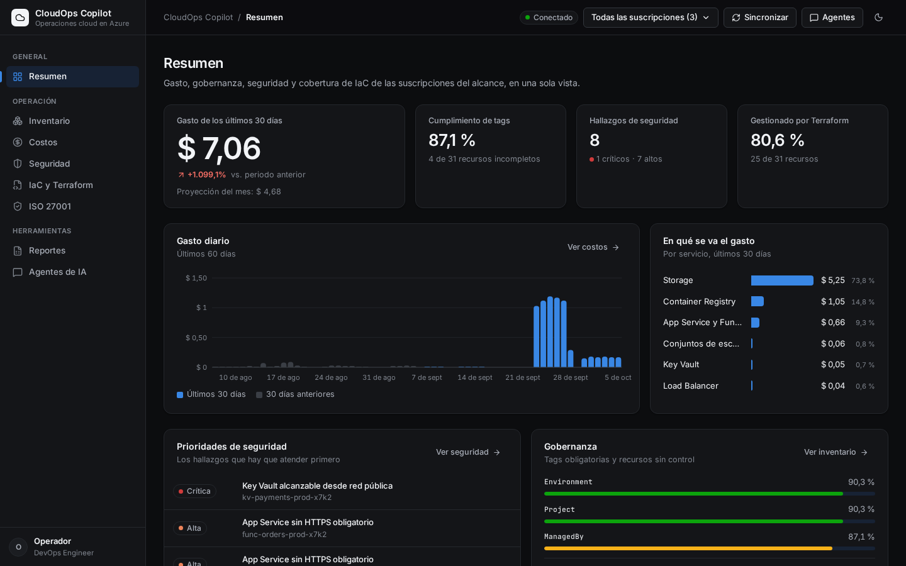
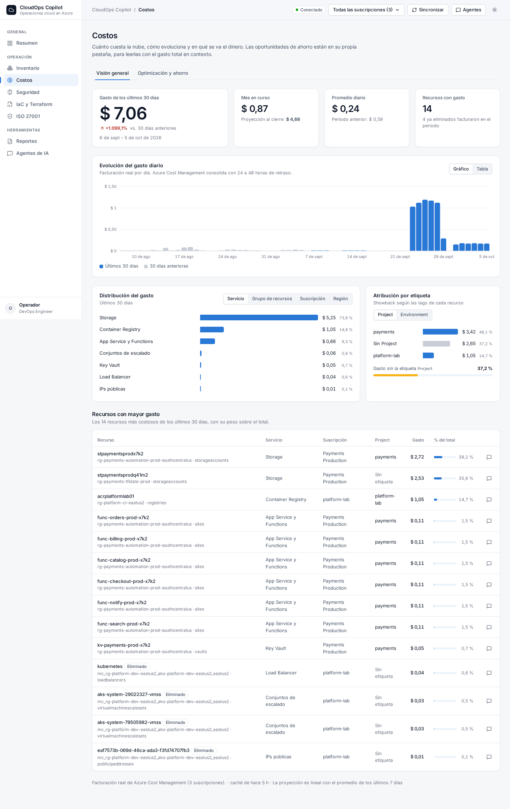
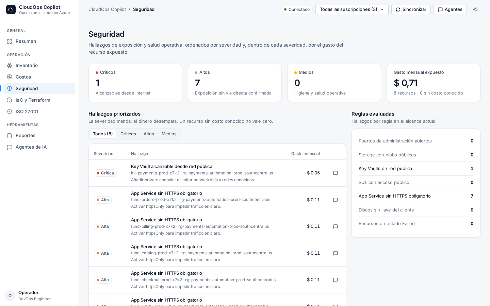
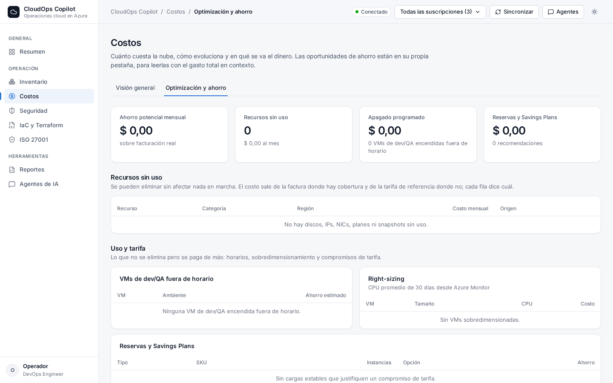
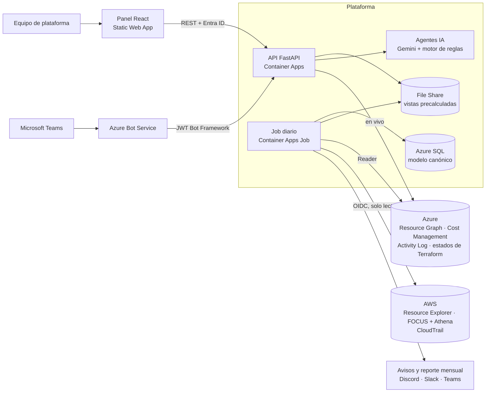

# CloudOps Copilot

[](https://github.com/miguelortiz13/cloudops-copilot/actions/workflows/ci.yml)
[](https://github.com/miguelortiz13/cloudops-copilot/actions/workflows/cd.yml)


**Copiloto de operaciones cloud para Azure y AWS.** Reúne en un solo panel, y en un chat con agentes de IA, las preguntas que un equipo de plataforma se hace todos los días:

- **¿Qué tenemos?** Inventario de todas las suscripciones de Azure y cuentas de AWS en un solo modelo, con cumplimiento de tags, candidatos a Shadow IT y quién creó cada recurso.
- **¿Cuánto cuesta y dónde se desperdicia?** FinOps sobre la facturación real (Cost Management y el export FOCUS de AWS), con presupuestos y anomalías.
- **¿Qué está expuesto?** Hallazgos de seguridad ordenados por severidad y por el dinero que hay detrás.
- **¿Qué está codificado?** Cobertura real de Terraform leída de los estados, y generación de HCL para importar lo que falta.
- **¿Qué le pasa al clúster?** Salud e incidencias de cualquier clúster de Kubernetes (AKS, EKS u on-premise) con un agente de solo lectura.
- **¿Qué tengo que saber hoy?** Avisos en Discord, Slack o Teams y un reporte ejecutivo mensual en PDF.

Todo con identidades de **solo lectura**: Reader en Azure y un rol de lectura en AWS asumido por federación, sin llaves guardadas: la plataforma observa y recomienda; los cambios los aprueba y aplica una persona. Se despliega en Azure por centavos al mes: Container Apps con escala a cero, un job diario, Azure SQL gratuita, Static Web App gratuita y Entra ID ([despliegue](docs/deployment.md)).

---

## Capturas

| Resumen (modo oscuro) | Costos: visión general |
|---|---|
|  |  |
| **Seguridad** | **Optimización y ahorro** |
|  |  |

## Arquitectura en una imagen



Detalle completo en [docs/architecture.md](docs/architecture.md).

## Inicio rápido

```bash
git clone git@github.com:miguelortiz13/cloudops-copilot.git
cd cloudops-copilot
make setup                 # virtualenv + npm ci + backend/.env desde el ejemplo
# completar backend/.env con un Service Principal de solo lectura
make dev                   # API en :8000, panel en :5173
```

O con Docker: `docker compose up --build` (API en `:8000`, panel en `:8080`).

Sin credenciales de Azure la plataforma arranca igual y responde en modo degradado; sin `GEMINI_API_KEY` el chat usa el motor de reglas local. Guía completa en [docs/getting-started.md](docs/getting-started.md).

## Módulos

| Módulo | Qué resuelve | Documento |
|---|---|---|
| Inventario y gobernanza | KPIs agregados en Resource Graph, matriz de tags, Shadow IT con regla de cuatro señales, histórico diario | [inventory-governance.md](docs/modules/inventory-governance.md) |
| Costos (FinOps) | Primero la visión global: gasto de 30 días, tendencia diaria, proyección y desgloses por servicio, grupo, suscripción, región y tag. Después, ahorro: recursos sin uso, right-sizing, reservas, presupuestos y anomalías | [finops.md](docs/modules/finops.md) |
| SecOps | NSG, storage, Key Vault, SQL, HTTPS; exposición priorizada por severidad × gasto | [secops.md](docs/modules/secops.md) |
| Cumplimiento | Estado de los controles de CIS Azure 2.0.0 e ISO 27001:2022 con su evidencia, catálogo de reglas y clasificación ISO de activos con corrección manual auditada | [compliance.md](docs/modules/compliance.md) |
| IaC | Cobertura real desde los estados de Terraform y generador de HCL con `import {}` | [iac.md](docs/modules/iac.md) |
| Agentes de IA | Chat de inventario, FinOps y SecOps con contexto acotado y reglas compartidas | [ai-agents.md](docs/modules/ai-agents.md) |
| Kubernetes | Clústeres de AKS, EKS o fuera de la nube con un agente de solo lectura: salud, nodos, cargas e incidencias | [kubernetes-sre.md](docs/modules/kubernetes-sre.md) |
| Avisos y reportes | Hallazgos críticos, recolectores caídos, anomalías de gasto y presupuestos en Discord, Slack o Teams; reporte ejecutivo mensual en PDF | [notifications-reports.md](docs/modules/notifications-reports.md) |
| Teams | Bot conversacional y reportes proactivos | [teams.md](docs/integrations/teams.md) |

## Estructura del repositorio

```
cloudops-copilot/
├── backend/                  API FastAPI y job diario (misma imagen)
│   ├── app/
│   │   ├── core/             configuración central, contenedor de servicios, roles y auditoría
│   │   ├── providers/        acceso a cada nube detrás de un contrato común (Azure y AWS)
│   │   ├── collectors/       pasos del job diario: inventario, costos, hallazgos, KPIs, reporte y avisos
│   │   ├── db/               modelo canónico (SQLAlchemy) sobre Azure SQL
│   │   ├── readmodel/        vistas del panel desde la base, precalculadas
│   │   ├── reports/          reporte ejecutivo mensual en PDF
│   │   ├── agents/           agente de chat y generador de IaC
│   │   ├── routers/          endpoints REST por módulo
│   │   ├── services/         lógica de dominio de las vistas en vivo
│   │   └── schemas/          modelos Pydantic
│   ├── migrations/           migraciones de Alembic
│   ├── pipelines/inventory/  pipeline semanal de inventario a Excel
│   └── tests/                unitarias, de contrato (respuestas grabadas) e integración
├── frontend/                 panel React + TypeScript + Vite, con Vitest y Playwright
├── infra/
│   ├── terraform/            infraestructura de la plataforma en Azure
│   └── modules/aws-onboarding/  federación, rol de lectura, Resource Explorer y export de costos en AWS
├── k8s-agent/                agente de solo lectura para clústeres de Kubernetes
├── integrations/teams-bot/   manifiesto de la app de Teams
├── scripts/                  dev, bootstrap del estado, deploy y destroy
└── docs/                     documentación
```

## Documentación

Empieza por el [índice de documentación](docs/README.md). Lo más consultado:

- [Requerimientos](docs/requirements.md), [arquitectura](docs/architecture.md), [flujos](docs/flows.md) y [modelo de datos](docs/data-model.md).
- [Operación](docs/operations.md): recursos, costo y tareas del día a día.
- [Configuración](docs/configuration.md): todas las variables de entorno.
- [Despliegue en Azure](docs/deployment.md): permisos, Terraform y publicación.
- [API](docs/api.md): catálogo de endpoints.
- [Seguridad](docs/security.md): modelo de amenazas y controles.
- [Plan de evolución](docs/plan/README.md): arquitectura objetivo, AWS y multinube, mejoras por módulo y hoja de ruta.
- [Pendientes e integraciones futuras](docs/roadmap.md).

## Comandos útiles

```bash
make help            # lista de objetivos
make test            # pruebas unitarias, sin tocar Azure
./scripts/smoke-test.sh  # prueba de humo del API desplegado
make lint            # ruff + eslint
make tf-validate     # terraform validate sin backend remoto
make deploy          # infraestructura + backend + frontend en Azure
```

## Licencia

[MIT](LICENSE) © 2026 Miguel Ortiz
