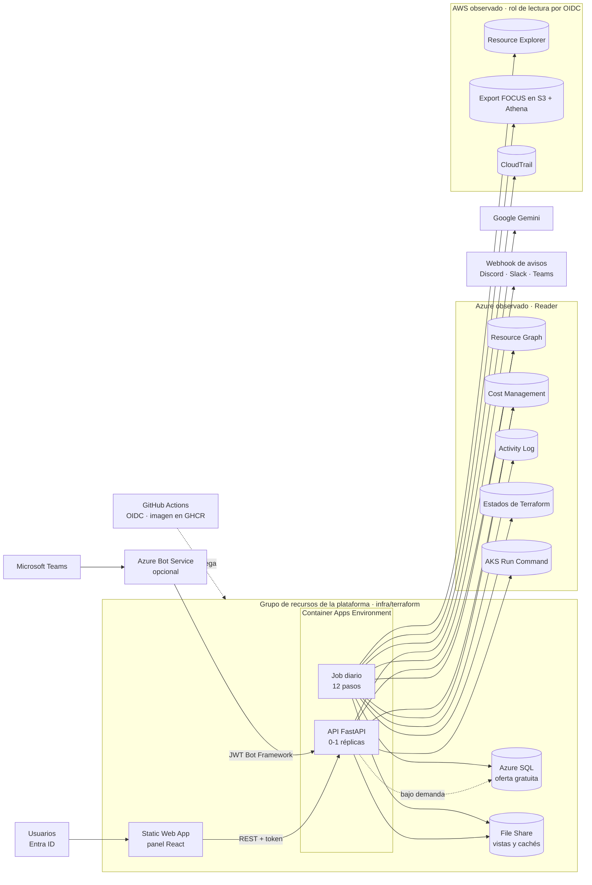
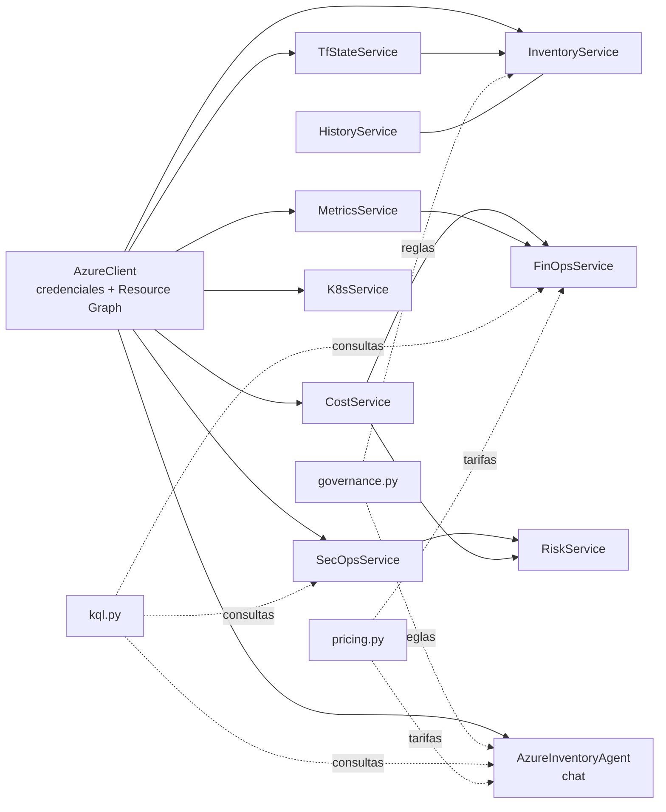
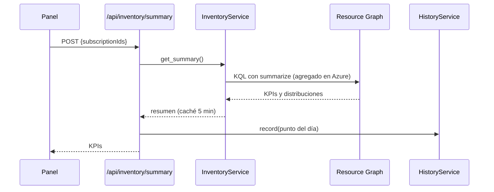
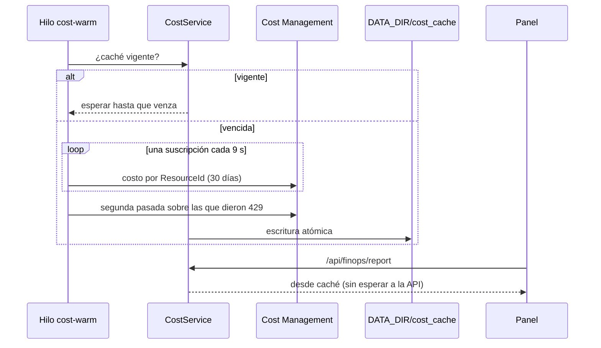

# Arquitectura

## Vista de componentes

La plataforma vive en un grupo de recursos de Azure y observa Azure y AWS sin permisos de escritura. El job diario es el centro: lee las dos nubes, guarda en Azure SQL y deja las vistas calculadas en el File Share, de donde el API las sirve sin despertar la base. El API también consulta Azure en vivo para lo que no está en la base (inventario en tiempo real, Kubernetes).



| Componente | Tecnología | Responsabilidad |
|---|---|---|
| Panel | React 19, TypeScript, Vite, MSAL | Vistas de inventario, costos, seguridad, IaC, cumplimiento, reportes, administración y chat |
| API | FastAPI, Python 3.13 | Endpoints REST, autenticación y roles, vistas desde caché, consultas en vivo |
| Job diario | Container Apps Job, misma imagen que el API | Recolectores, vistas precalculadas, reporte mensual y avisos ([flujo](flows.md#job-diario-de-recolección)) |
| Base de datos | Azure SQL serverless, SQLAlchemy, Alembic | Modelo canónico multinube ([modelo de datos](data-model.md)) |
| Proveedores | Azure SDK y REST; boto3 con credenciales federadas | Una implementación por nube detrás del mismo contrato ([ADR 0006](adr/0006-abstraccion-de-proveedores.md)) |
| Agentes | Gemini + motor de reglas | Respuestas en lenguaje natural sobre el contexto del tenant |
| Pipeline | Scripts Python + bash | Exportación semanal del inventario a un Excel maestro con snapshots |
| Infraestructura | Terraform (azurerm, azuread, aws) | Container Apps, Static Web App, Azure SQL, identidades, Entra ID, almacenamiento y el módulo `aws-onboarding` |

## Backend por capas

```
app/main.py            ← crea FastAPI, middlewares (auth, CORS) e incluye routers
app/core/config.py     ← única fuente de configuración (lee .env)
app/core/container.py  ← crea los servicios una vez y los comparte; precarga de costos
app/core/deps.py       ← servicios como dependencias tipadas de FastAPI (Depends)
app/routers/*          ← traducen HTTP ↔ servicios; sin lógica de dominio
app/providers/base.py  ← contrato por capacidad y modelo canónico (ADR 0006)
app/providers/azure/*  ← AzureClient (credenciales, Resource Graph) y AzureProvider (el contrato sobre Azure)
app/providers/aws/*    ← AwsProvider: Resource Explorer, Athena (FOCUS) y CloudTrail con credenciales federadas
app/collectors/*       ← pasos del job diario (inventario, costos, hallazgos, KPIs, reporte, avisos)
app/db/*               ← modelo canónico (SQLAlchemy) y conexión a Azure SQL
app/readmodel/*        ← vistas del panel desde la base, precalculadas por el job
app/reports/*          ← reporte ejecutivo mensual en PDF
app/services/*         ← lógica de dominio
app/agents/*           ← agente conversacional y generador de IaC
app/llm/*              ← interfaz de modelos de lenguaje (Gemini con google-genai) y límite por usuario
app/schemas/*          ← contratos Pydantic
```

### Servicios y dependencias



- **`AzureClient`** (`app/providers/azure/`) encapsula la autenticación (Service Principal o `DefaultAzureCredential`) y el cliente de Resource Graph con caché y paginación por `skip_token`. Es la única puerta a Azure: una sola instancia compartida por todos los servicios.
- **`AzureInventoryAgent`** solo arma contexto y responde el chat; consulta Azure a través del mismo cliente.
- **El agente recibe los mismos servicios que el panel** (`attach_services`): comparte su caché y, sobre todo, sus reglas. Ver [ADR 0002](adr/0002-una-definicion-por-regla.md).
- **Los servicios se crean de forma perezosa** en la primera petición (`container.get_services`), para que el arranque no dependa de que Azure responda.

### Módulos de reglas compartidas

| Módulo | Define |
|---|---|
| `services/governance.py` | Evidencia de IaC, custodio, recursos derivados, Shadow IT, expresiones KQL equivalentes |
| `services/kql.py` | Catálogo de consultas de dominio (huérfanos, exposición, etc.) |
| `services/pricing.py` | Tarifas de referencia para estimaciones cuando no hay facturación |
| `core/config.py` | Tags obligatorias, dimensiones de showback, nombre de la organización |

## Flujos principales

Los flujos del job diario, los avisos, el reporte mensual, el inicio de sesión y el despliegue están en [flujos](flows.md). Aquí, los de las vistas en vivo.

### Resumen de inventario



Los KPIs se calculan **en Resource Graph**, no descargando el inventario: el tiempo de respuesta deja de crecer con el tamaño del tenant (~1,3 s tanto con 600 como con 10.000 recursos). La implementación en memoria se conserva como referencia y respaldo, y `tests/integration/test_inventory_kpis.py` verifica que ambos caminos producen los mismos números.

### Costos con precarga



Cost Management limita la tasa con dureza (`429`). La precarga va en segundo plano y pausada, y la caché se persiste en `DATA_DIR` para que un reinicio no gaste la cuota de nuevo. Ver [ADR 0003](adr/0003-cache-de-costos-persistente.md).

### Chat

1. El router identifica el agente (`inventory`, `finops`, `secops`).
2. El agente arma el contexto con consultas paralelas bajo un **presupuesto de tiempo único** (25 s); lo que no llega se declara en `consultas_incompletas`.
3. Las listas viajan **acotadas** (`{muestra, total, truncado}`) para que el modelo diga "hay 212, te muestro 15".
4. Si no hay modelo configurado o falla (`app/llm`), responde el **motor de reglas** con los mismos datos.

## Persistencia

La historia vive en Azure SQL (inventario, costos, hallazgos con su ciclo de vida, clasificación, KPIs, ejecuciones del job y auditoría). El File Share (`DATA_DIR`) guarda las vistas precalculadas, la caché de costos en vivo, el Excel del pipeline y la sesión de Teams. Detalle en [modelo de datos](data-model.md).

## Decisiones de diseño

Las decisiones relevantes están registradas como ADR en [docs/adr](adr/README.md).
