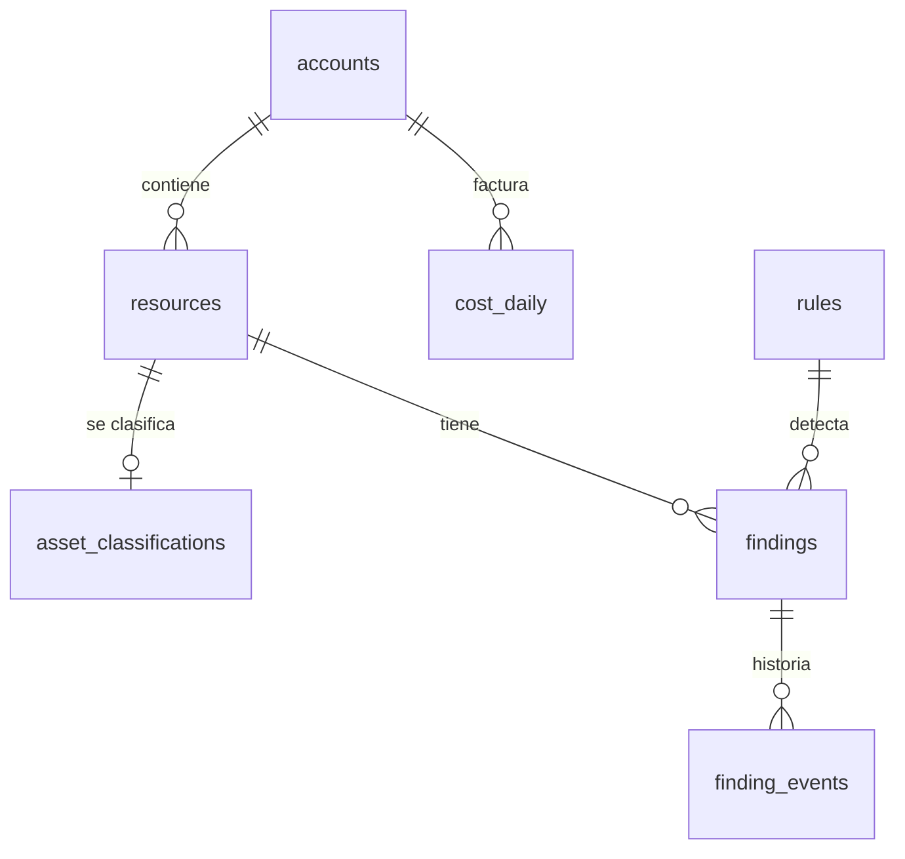

# Modelo de datos

Diez tablas en Azure SQL (oferta gratuita serverless), definidas con SQLAlchemy en [`backend/app/db/models.py`](../backend/app/db/models.py) y migradas con Alembic (`backend/migrations`). El modelo es canónico: la misma tabla guarda Azure y AWS, y el prefijo del `uid` dice de qué nube viene (`azure:sub/…`, `aws:account/…`). La razón está en el [ADR 0007](adr/0007-almacen-de-datos-y-recolectores.md); los costos siguen FOCUS ([ADR 0008](adr/0008-focus-como-modelo-de-costos.md)).

| Tabla | Guarda | Clave y relaciones |
|---|---|---|
| `accounts` | Suscripciones de Azure y cuentas de AWS, con nombre y padre (management group u organización) | `uid` |
| `resources` | Inventario canónico: tipo canónico y nativo, región, grupo, tags, `in_iac_state`, `created_by`, primera y última vez visto, `deleted_at` | `uid`; `account_uid` → `accounts` |
| `cost_daily` | Costo diario por cuenta, recurso y servicio, facturado y efectivo, con moneda y fuente (`query` o `export`) | `account_uid`, `resource_uid` |
| `rules` | Catálogo de reglas: capacidad, severidad por defecto, marcos (CIS, ISO), remediación, detección | `id` (por ejemplo `storage.public-access`) |
| `findings` | Un hallazgo por regla y recurso: severidad, estado, dueño, vencimiento de la aceptación | `rule_id` → `rules`; único por (regla, recurso) |
| `finding_events` | Historia de cada hallazgo: detectado, estado, resuelto, reabierto, vencido; actor y nota | `finding_id` → `findings` |
| `asset_classifications` | Clasificación ISO (confidencialidad, integridad, disponibilidad), custodio y método (automático o manual) | `resource_uid` → `resources` |
| `kpi_daily` | KPIs de gobernanza por día y alcance | día, alcance, métrica |
| `collector_runs` | Cada paso del job: estado (`ok`, `parcial`, `error`), elementos, detalle JSON y error. También guarda la marca de agua de los avisos y el mes del último reporte enviado | `collector` |
| `audit_log` | Acciones de los usuarios: actor, rol, acción, objetivo y resultado | — |

## Lecturas sin abrir la base

Las vistas que el panel usa a diario no tocan la base. Al terminar, el job deja calculadas las vistas por defecto (costos de 30 días, del mes en curso y del anterior; hallazgos; KPIs de 90 días) en el File Share que también monta el API ([`app/readmodel`](../backend/app/readmodel)). El API las sirve hasta la siguiente corrida. Así la base se despierta una vez al día y el consumo queda muy por debajo del cupo gratuito ([cálculo](plan/05-infraestructura.md#presupuesto-de-cómputo-de-la-base-de-datos)).

Solo despiertan la base una consulta fuera de esas vistas (por ejemplo, 90 días de costos), un cambio de estado de un hallazgo o la descarga del reporte mensual.

## Otros datos en el File Share

| Ruta | Contenido | Escribe |
|---|---|---|
| `cost_cache/` | Gasto por recurso para las vistas en vivo de Azure | `CostService` y el paso `costcache` |
| `readmodel/` | Vistas precalculadas del panel | paso `readmodel` |
| `Azure_IaC_Inventario.xlsx` y `snapshots/` | Excel maestro y copias semanales | pipeline de inventario |
| `teams_session.json` | Conversación para reportes proactivos | webhook de Teams |
