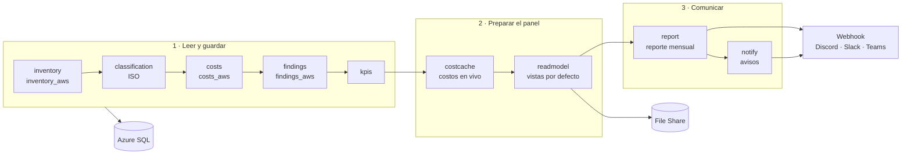
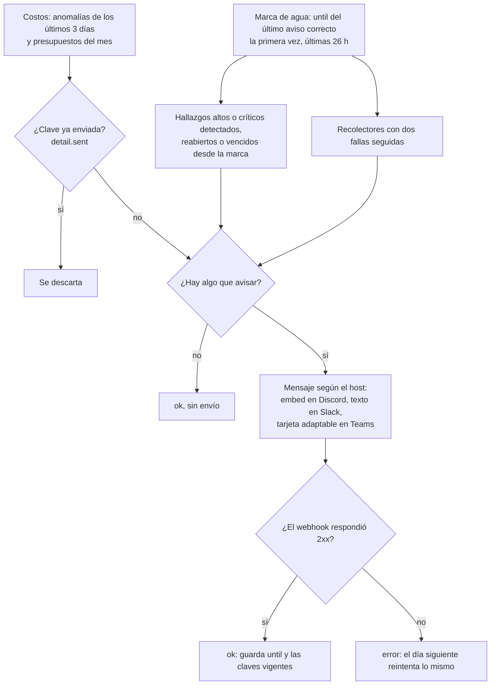
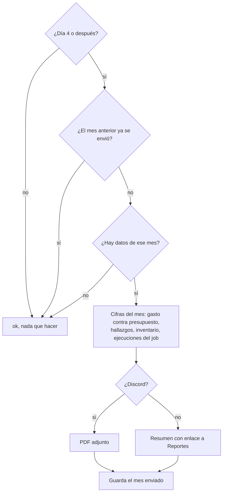
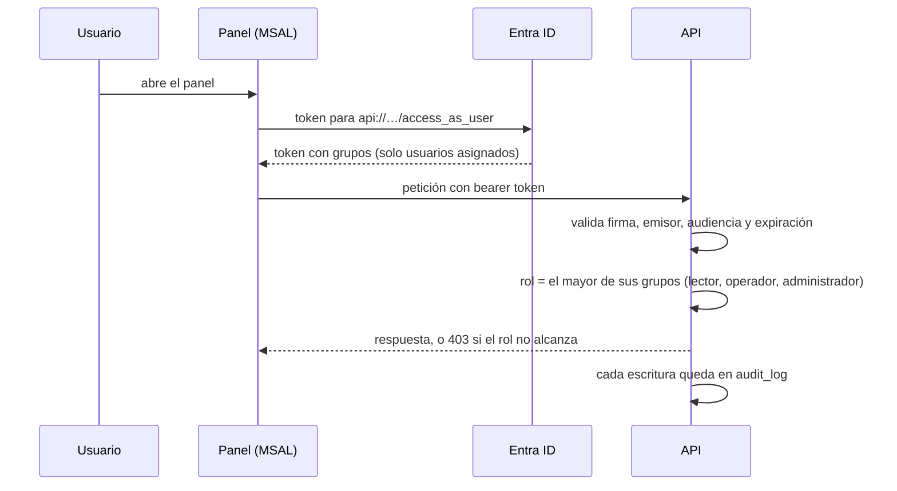
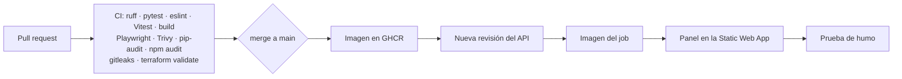

# Flujos del sistema

Cinco flujos mueven la plataforma. El principal es el job diario, que lee las dos nubes y deja todo listo para el panel; los avisos y el reporte mensual son sus últimos pasos. Los componentes que aparecen aquí están descritos en [arquitectura](architecture.md).

## Job diario de recolección

Un Container Apps Job corre una vez al día (`collector_cron`, por defecto 06:00 UTC) y ejecuta 12 pasos en orden ([`app/collectors/run.py`](../backend/app/collectors/run.py)). Cada paso usa su propia transacción y deja su resultado en `collector_runs`: si uno falla (por ejemplo, AWS), los demás siguen y el job termina marcado con error.

- Los pasos `*_aws` solo corren si la federación con AWS está configurada.
- Un paso termina `ok`, `parcial` (parte del alcance no respondió; lo leído vale) o `error`. Administración muestra el último estado de cada uno.
- Reejecutar a mano: `az containerapp job start` sobre el job, o solo algunos pasos con `python -m app.collectors.run --only costs,findings`.

## Avisos (paso `notify`)

Detalle de los eventos en [avisos y reportes](modules/notifications-reports.md).

## Reporte mensual (paso `report`)

Se espera al día 4 porque los costos llegan con hasta 72 h de retraso. Desde el panel se descarga el de cualquier mes (`GET /api/reports/monthly?month=AAAA-MM`).

## Inicio de sesión y autorización

Detalle en [seguridad](security.md#autenticación-del-api).

## Despliegue continuo

GitHub Actions entra a Azure por OIDC, sin secretos guardados. La infraestructura se cambia aparte, con `terraform apply` manual ([operación](operations.md#cambios-de-infraestructura)).
