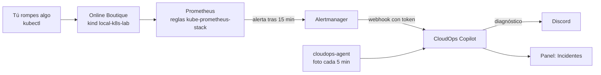

# Laboratorio: diagnóstico de incidentes con IA

Rompes a propósito Online Boutique en tu clúster local, Prometheus lo detecta, Alertmanager avisa a CloudOps Copilot y el agente de IA diagnostica la causa con herramientas de solo lectura. Al final comparas su diagnóstico con la causa que tú provocaste y lo marcas en el panel.

**Lo que vas a practicar:** cómo nace una alerta (reglas de Prometheus y sus tiempos), cómo la agrupa Alertmanager, qué evidencia usa un diagnóstico y cómo se mide si fue correcto.



## Requisitos

- El laboratorio `local-k8s-lab` encendido (`make up && make deploy` en `devops-sre-lab/local-k8s-lab`), con el stack de monitoreo en `monitoring`.
- El agente de CloudOps reportando como `local-k8s-lab` (página *Kubernetes* del panel; ver [Kubernetes](../modules/kubernetes-sre.md#conectar-un-clúster)).
- El webhook de Discord configurado en CloudOps (es el mismo de los avisos).

## Paso 1. Conectar Alertmanager a CloudOps

El token es una credencial: no lo pegues en chats ni en el repositorio.

```bash
cd ~/Proyectos/cloudops-copilot/infra/terraform
TOKEN="$(terraform output -raw alerts_ingest_token)"
API="$(terraform output -raw api_url)"
kubectl --context kind-boutique -n cloudops create secret generic cloudops-alerts --from-literal=token="$TOKEN"
unset TOKEN
```

Crea la ruta de Alertmanager hacia CloudOps solo para el namespace de la tienda:

```bash
kubectl --context kind-boutique apply -f - <<EOF
apiVersion: monitoring.coreos.com/v1alpha1
kind: AlertmanagerConfig
metadata:
  name: cloudops-copilot
  namespace: cloudops
  labels:
    release: kube-prometheus-stack   # el selector de este Alertmanager
spec:
  route:
    receiver: cloudops
    groupBy: [alertname, namespace]
    groupWait: 30s
    groupInterval: 5m
    repeatInterval: 4h
    matchers:
      - name: namespace
        value: boutique
  receivers:
    - name: cloudops
      webhookConfigs:
        - url: "${API}/api/alerts/alertmanager?cluster=local-k8s-lab"
          sendResolved: true
          httpConfig:
            authorization:
              type: Bearer
              credentials:
                name: cloudops-alerts
                key: token
EOF
```

**Para revisar:** `kubectl --context kind-boutique -n monitoring logs alertmanager-kube-prometheus-stack-alertmanager-0 -c alertmanager --tail=20` no debe mostrar errores de configuración.

## Paso 2. Ejercicios

Cada ejercicio: rompes, esperas la alerta, lees el diagnóstico (Discord y *Incidentes* en el panel), lo comparas con lo que hiciste, lo marcas como **Correcto** o **Incorrecto** y reparas. Las reglas por defecto esperan **15 minutos** antes de disparar: es a propósito, para no despertar a nadie por un parpadeo. Anota los tiempos.

Para ver qué está por dispararse sin esperar a Discord: `kubectl --context kind-boutique -n monitoring port-forward svc/kube-prometheus-stack-prometheus 9090` y abre http://localhost:9090/alerts.

### Ejercicio 1. Una imagen que no existe (despliegue fallido)

```bash
IMG="$(kubectl --context kind-boutique -n boutique get deploy currencyservice -o jsonpath='{.spec.template.spec.containers[0].image}')"
kubectl --context kind-boutique -n boutique set image deploy/currencyservice server="${IMG%:*}:v9.9.9"
```

- **Qué esperar:** el pod nuevo queda en `ImagePullBackOff` (el viejo sigue atendiendo). A los 15 minutos dispara `KubePodNotReady`.
- **Diagnóstico correcto si dice:** imagen o etiqueta `v9.9.9` inexistente, citando el evento `Failed to pull image`.
- **Reparar:** `kubectl --context kind-boutique -n boutique rollout undo deploy/currencyservice`. Unos minutos después llega *Resuelto*.

### Ejercicio 2. Sin memoria (OOMKilled)

```bash
kubectl --context kind-boutique -n boutique set resources deploy/recommendationservice --limits=memory=24Mi --requests=memory=16Mi
```

- **Qué esperar:** el contenedor muere por memoria (`OOMKilled`) y entra en `CrashLoopBackOff`. Dispara `KubePodCrashLooping`.
- **Diagnóstico correcto si dice:** falta de memoria o límite de memoria demasiado bajo.
- **Reparar:** `kubectl --context kind-boutique -n boutique rollout undo deploy/recommendationservice`.

### Ejercicio 3. Un nodo caído

```bash
docker stop boutique-worker2
```

- **Qué esperar:** el nodo pasa a `NotReady`, sus pods quedan `Unknown` y se reprograman. Disparan `KubeNodeNotReady` y `KubeNodeUnreachable`. Además, `k8s-watch` avisa por su lado (incidencia crítica del nodo).
- **Diagnóstico correcto si dice:** el nodo `boutique-worker2` no responde.
- **Reparar:** `docker start boutique-worker2`.

### Ejercicio 4 (sin alerta). Un servicio que no apunta a nada

```bash
kubectl --context kind-boutique -n boutique patch svc currencyservice -p '{"spec":{"selector":{"app":"currency-service"}}}'
```

Las reglas por defecto **no** tienen una alerta para esto: la tienda falla sin que Alertmanager diga nada. Pregúntale al chat del panel *"¿qué está fallando en local-k8s-lab?"*. Debería encontrar el servicio sin endpoints (incidencia de la página *Kubernetes*).

- **Para pensar:** ¿qué alerta habría que agregar (por ejemplo, sobre `kube_endpoint_address_available`)?
- **Reparar:** `kubectl --context kind-boutique -n boutique patch svc currencyservice -p '{"spec":{"selector":{"app":"currencyservice"}}}'`.

## Paso 3. Medir

| Ejercicio | Alerta | Minutos hasta el aviso | ¿Diagnóstico correcto? | Minutos hasta *Resuelto* |
|---|---|---|---|---|
| 1. Imagen inexistente | | | | |
| 2. OOMKilled | | | | |
| 3. Nodo caído | | | | |

El objetivo de la plataforma es acertar al menos 9 de cada 10 diagnósticos. Tus marcas en el panel alimentan esa medición.

## Limpieza

```bash
kubectl --context kind-boutique -n cloudops delete alertmanagerconfig cloudops-copilot
kubectl --context kind-boutique -n cloudops delete secret cloudops-alerts
```
