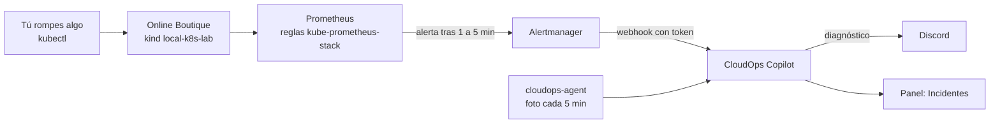

# Laboratorio: diagnóstico de incidentes con IA

Rompes a propósito Online Boutique en tu clúster local, Prometheus lo detecta, Alertmanager avisa a CloudOps Copilot y el agente de IA diagnostica la causa con herramientas de solo lectura. Al final comparas su diagnóstico con la causa que tú provocaste y lo marcas en el panel.

**Lo que vas a practicar:** cómo nace una alerta (reglas de Prometheus y sus tiempos), cómo la agrupa Alertmanager, qué evidencia usa un diagnóstico y cómo se mide si fue correcto.



## Requisitos

- El laboratorio `local-k8s-lab` encendido (`make up && make deploy` en `devops-sre-lab/local-k8s-lab`), con el stack de monitoreo en `monitoring`.
- El agente de CloudOps reportando como `local-k8s-lab` (página *Kubernetes* del panel; ver [Kubernetes](../modules/kubernetes-sre.md#conectar-un-clúster)).
- El webhook de Discord configurado en CloudOps (es el mismo de los avisos).

## Paso 1. Conectar Alertmanager a CloudOps

El token es una credencial: no lo pegues en chats ni en el repositorio.

```bash
cd ~/Proyectos/cloudops-copilot/infra/terraform
terraform init -backend-config=backend.hcl -input=false >/dev/null   # si nunca se inicializó en esta copia
TOKEN="$(terraform output -raw alerts_ingest_token)"
API="$(terraform output -raw api_url)"
kubectl --context kind-boutique -n cloudops create secret generic cloudops-alerts --from-literal=token="$TOKEN"
unset TOKEN
```

Crea la ruta de Alertmanager hacia CloudOps solo para el namespace de la tienda:

```bash
kubectl --context kind-boutique apply -f - <<EOF
apiVersion: monitoring.coreos.com/v1alpha1
kind: AlertmanagerConfig
metadata:
  name: cloudops-copilot
  namespace: cloudops
  labels:
    release: kube-prometheus-stack   # el selector de este Alertmanager
spec:
  route:
    receiver: cloudops
    groupBy: [namespace, pod]   # dos reglas sobre el mismo pod = un solo incidente
    groupWait: 30s
    groupInterval: 5m
    repeatInterval: 4h
    matchers:
      - name: namespace
        value: boutique
  receivers:
    - name: cloudops
      webhookConfigs:
        - url: "${API}/api/alerts/alertmanager?cluster=local-k8s-lab"
          sendResolved: true
          httpConfig:
            authorization:
              type: Bearer
              credentials:
                name: cloudops-alerts
                key: token
EOF
```

**Para revisar:** `kubectl --context kind-boutique -n monitoring logs alertmanager-kube-prometheus-stack-alertmanager-0 -c alertmanager --tail=20` no debe mostrar errores de configuración.

## Paso 2. Ejercicios

Cada ejercicio: rompes, esperas la alerta, lees el diagnóstico (Discord y *Incidentes* en el panel), lo comparas con lo que hiciste, lo marcas como **Correcto** o **Incorrecto** y reparas. Anota los tiempos.

Las alertas que vas a ver son las reglas SRE de tu laboratorio (`online-boutique-sre-alerts`, del proyecto `observability-stack`), más rápidas que las de kube-prometheus-stack (que esperan 15 minutos):

| Alerta | Severidad | Espera | Cuándo |
|---|---|---|---|
| `PodNotReady` | warning (alta) | 5 min | Un pod de la tienda en `Pending`, `Unknown` o `Failed` |
| `PodCrashLooping` | critical | 2 min | Reinicios en los últimos 15 min |
| `OnlineBoutiqueServiceUnavailable` | critical | 1 min | Un deployment sin réplicas disponibles |
| `FrontendHighErrorRate` | critical | 1 min | El frontend responde con errores (síntoma) |

La ruta hacia CloudOps solo deja pasar las alertas con `namespace=boutique`: las de nodo (sin namespace) no llegan, pero sí sus efectos en los pods.

Agrupar por `namespace` y `pod` importa: en la primera prueba, la ruta agrupaba por `alertname` y la misma falla abrió dos incidentes (`PodNotReady` del lab a los 5 minutos y `KubePodNotReady` por defecto a los 15).

Para ver qué está por dispararse sin esperar a Discord: `kubectl --context kind-boutique -n monitoring port-forward svc/kube-prometheus-stack-prometheus 9090` y abre http://localhost:9090/alerts.

### Ejercicio 1. Una imagen que no existe (despliegue fallido)

```bash
IMG="$(kubectl --context kind-boutique -n boutique get deploy currencyservice -o jsonpath='{.spec.template.spec.containers[0].image}')"
kubectl --context kind-boutique -n boutique set image deploy/currencyservice server="${IMG%:*}:v9.9.9"
```

- **Qué esperar:** el pod nuevo queda en `ImagePullBackOff` (el viejo sigue atendiendo). Dispara `PodNotReady` a los ~6 minutos y el diagnóstico llega al minuto siguiente.
- **Diagnóstico correcto si dice:** imagen o etiqueta `v9.9.9` inexistente, citando el evento `Failed to pull image` y, con el agente 1.3.0, el despliegue que la introdujo (revisión, hora e imagen anterior).
- **Probado de punta a punta** (30-oct-2026): roto a las 04:10, alerta a las 04:16, diagnóstico de confianza alta con el evento `NotFound` y la sugerencia de `rollout undo`.
- **Reparar:** `kubectl --context kind-boutique -n boutique rollout undo deploy/currencyservice`. Unos minutos después llega *Resuelto*.

### Ejercicio 2. Sin memoria (OOMKilled)

```bash
kubectl --context kind-boutique -n boutique set resources deploy/recommendationservice --limits=memory=24Mi --requests=memory=16Mi
```

- **Qué esperar:** el contenedor muere por memoria (`OOMKilled`) y entra en `CrashLoopBackOff`. Dispara `PodCrashLooping` (crítica) en pocos minutos.
- **Diagnóstico correcto si dice:** falta de memoria o límite de memoria demasiado bajo.
- **Reparar:** `kubectl --context kind-boutique -n boutique rollout undo deploy/recommendationservice`.

### Ejercicio 3. Un nodo caído

```bash
docker stop boutique-worker2
```

- **Qué esperar:** el nodo pasa a `NotReady` y, a los 5 minutos de gracia de Kubernetes, sus pods de la tienda quedan `Unknown` y se reprograman: dispara `PodNotReady` para esos pods. Además, `k8s-watch` avisa por su lado la incidencia crítica del nodo.
- **Diagnóstico correcto si dice:** el nodo `boutique-worker2` no responde.
- **Reparar:** `docker start boutique-worker2`.

### Ejercicio 4. Una alerta por síntoma: un servicio que no apunta a nada

```bash
kubectl --context kind-boutique -n boutique patch svc currencyservice -p '{"spec":{"selector":{"app":"currency-service"}}}'
```

Ningún pod falla: el servicio `currencyservice` deja de tener endpoints y el frontend empieza a responder con errores. La alerta que llega es de **síntoma** (`FrontendHighErrorRate`), no de la causa: es el caso más difícil para el diagnóstico, porque tiene que ir del frontend al servicio sin endpoints.

- **Diagnóstico correcto si dice:** el servicio `currencyservice` no tiene endpoints porque su selector (`app=currency-service`) no coincide con los pods.
- **Para pensar:** si el diagnóstico no llega a la causa, pregúntale al chat del panel *"¿qué está fallando en local-k8s-lab?"*. ¿Qué alerta de causa agregarías (por ejemplo, sobre `kube_endpoint_address_available`)?
- **Reparar:** `kubectl --context kind-boutique -n boutique patch svc currencyservice -p '{"spec":{"selector":{"app":"currencyservice"}}}'`.

### Ejercicio 5. Una tormenta (reinicio de los nodos) y un mantenimiento silenciado

Así pasó de verdad el 5-nov-2026: al arrancar la máquina, los pods de la tienda se reiniciaron y llegaron seis `PodCrashLooping` a la vez, cada uno con su incidente y su diagnóstico. Desde la gestión de incidentes, eso es una **tormenta**: un solo diagnóstico buscando la causa común.

```bash
docker restart boutique-worker boutique-worker2
```

- **Qué esperar:** los contenedores de los dos workers se reinician y sus pods suman un reinicio. Como `PodCrashLooping` cuenta reinicios en 15 minutos, a los ~2 minutos dispara para varios pods, cada uno en su grupo de Alertmanager. Desde el tercero dentro de la ventana (120 s, *Plataforma → Ajustes*), los demás cuelgan del primero: en el panel ves **un** incidente "Tormenta en local-k8s-lab: N incidentes" y en Discord **un** aviso, no N.
- **Diagnóstico correcto si dice:** reinicio de los nodos (o de la máquina) como causa común, no una falla de cada aplicación.
- **Después, practica la gestión:**
  1. *Reconocer* el incidente y dejar una nota con lo que hiciste.
  2. Cerrarlo como **Ruido** (fue a propósito) y marcar el diagnóstico.
  3. Mirar el **borrador de post-mortem** (si cerraste como *Solucionado*, o cuando Alertmanager avise que se resolvió).
- **Ahora, el mantenimiento planificado:** en *Operación → Silencios*, silencia `clúster=local-k8s-lab`, `alerta=PodCrashLooping` durante 1 hora con el motivo "mantenimiento", y repite el `docker restart`. No debe abrirse ningún incidente ni llegar ningún aviso. Quita el silencio al terminar.
- **Para pensar:** ¿qué umbral de tormenta usarías en un clúster con 200 pods? ¿Y qué pasa si la tormenta mezcla una falla real con el ruido? (Pista: abre el incidente padre y revisa la lista de agrupados.)
- **Estado:** escrito el 7-nov-2026 a partir del caso real; la agrupación está probada con datos simulados y falta repetirla en el laboratorio.
- **Reparar:** nada; los pods vuelven solos. Si alguno queda mal, `kubectl --context kind-boutique -n boutique get pods`.

## Paso 3. Medir

| Ejercicio | Alerta | Minutos hasta el aviso | ¿Diagnóstico correcto? | Minutos hasta *Resuelto* |
|---|---|---|---|---|
| 1. Imagen inexistente | PodNotReady | | | |
| 2. OOMKilled | PodCrashLooping | | | |
| 3. Nodo caído | PodNotReady | | | |
| 4. Selector mal escrito | FrontendHighErrorRate | | | |
| 5. Tormenta | PodCrashLooping (varios) | | | |

El objetivo de la plataforma es acertar al menos 9 de cada 10 diagnósticos. Tus marcas en el panel alimentan esa medición, que se ve arriba en *Incidentes* (precisión del diagnóstico) y cada lunes en el resumen semanal.

## Limpieza

```bash
kubectl --context kind-boutique -n cloudops delete alertmanagerconfig cloudops-copilot
kubectl --context kind-boutique -n cloudops delete secret cloudops-alerts
```
