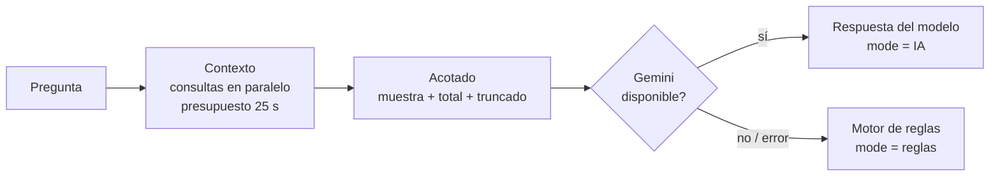

# Agentes de IA

Código: [`ai/`](../../backend/app/ai) (motor con herramientas), [`agents/azure_agent.py`](../../backend/app/agents/azure_agent.py) (respaldo), [`routers/chat.py`](../../backend/app/routers/chat.py).

## Motor con herramientas (chat del panel)

Con un modelo que admite herramientas (Gemini), el chat del panel responde con el motor de agentes ([`app/ai`](../../backend/app/ai), [plan 09](../plan/09-agentes-ia.md)): el modelo pide los datos que necesita, recibe el resultado y sigue hasta responder. Ya no depende de un contexto precargado.

| Herramienta | Qué devuelve | Cita |
|---|---|---|
| `buscar_recursos` | Recursos de Azure, AWS y Kubernetes por nombre, nube, tipo, cuenta, Terraform o creador, ordenados por gasto | Inventario |
| `recursos_nuevos` | Lo aparecido en los últimos N días, con quién lo creó; opcionalmente solo fuera de Terraform | Inventario |
| `hallazgos` | Hallazgos por severidad, estado, nube o texto, con remediación | Gestión de hallazgos |
| `costos` | Gasto de un periodo, comparación y los que más gastan por cuenta, servicio y recurso | Historial de costos |
| `cumplimiento` | Controles de CIS e ISO y cuáles no cumplen | Cumplimiento |
| `cambios_recientes` | Despliegues de Kubernetes de las últimas horas (revisión, hora, imagen anterior y nueva, réplicas listas) y recursos nuevos de la nube | Kubernetes, inventario |
| `clusters_kubernetes` / `estado_cluster` | Flota con salud y soporte; incidencias, pods con su log, cargas, nodos y eventos (acotables por namespace y objeto) | Kubernetes |

- **Solo lectura**: las herramientas leen las mismas vistas que el panel (con su caché) y las fotos de Kubernetes; no consultan la nube ni ejecutan nada.
- **Citas**: cada resultado trae el enlace a la vista que lo respalda y el modelo lo cita como `[ver en el panel](#/...)`. El panel solo vuelve clicables los enlaces propios (`#/...`).
- **Topes**: hasta 8 llamadas a herramientas y 90 s por pregunta; al llegar, el modelo responde con lo que tiene. Un resultado de más de 30.000 caracteres se rechaza pidiendo filtros.
- **Respaldo**: si el modelo no admite herramientas o falla, responde el agente anterior (contexto precargado o motor de reglas). La respuesta indica el modo (`llm_gemini_herramientas`).
- **Kubernetes**: la pestaña *Kubernetes* de la consola sigue usando su chat sobre la foto (`/api/k8s/chat`).

### Evaluación

[`backend/eval/agentes.py`](../../backend/eval/agentes.py) siembra una base con datos conocidos y una foto de Kubernetes, y hace 8 preguntas con respuesta verificable (conteos, quién gasta más, recursos creados a mano, causa de un CrashLoop, fin de soporte…). Usa el modelo real:

```bash
cd backend && GEMINI_API_KEY=... python -m eval.agentes
```

Primera medición (29-oct-2026, `gemini-3.5-flash`): **8 de 8 (100 %)**, objetivo 90 %. En la CI corren las pruebas del bucle con un modelo simulado (`tests/unit/test_ai_agente.py`).

## Agentes anteriores (respaldo)

| Agente | `agent_type` | Contexto que recibe |
|---|---|---|
| Inventario y gobernanza | `inventory` | Recursos, grupos, tipos, regiones, cumplimiento de tags, cobertura IaC, recursos sin custodio |
| FinOps | `finops` | Reporte de FinOps (huérfanos con costo real, showback, anomalías), tarifas de referencia |
| SecOps | `secops` | Reporte de SecOps y exposición priorizada |
| SRE Kubernetes | — (`/api/k8s/chat`) | Foto del clúster; ver [kubernetes-sre.md](kubernetes-sre.md) |

Responden en español, con tablas comparativas y comandos `az` o `kubectl` exactos. Se presentan como agentes de `ORG_NAME`.

## Cómo se arma una respuesta



### Una sola definición por regla

Cada regla —qué es un disco huérfano, un Key Vault expuesto, un recurso gestionado por IaC— vive en `kql.py`, `governance.py` o `pricing.py`, y de ahí la leen el panel, los reportes y el chat. El agente **no consulta por su cuenta**: recibe los servicios del panel (`attach_services`) y hereda sus reglas y su caché.

Esto corrigió divergencias reales: el chat contaba como públicas todas las cuentas de almacenamiento mientras el panel filtraba por `allowBlobPublicAccess`, y el reporte de costo del chat publicaba estimaciones bajo una clave llamada "costo real". Ver [ADR 0002](../adr/0002-una-definicion-por-regla.md).

### Presupuesto de contexto

- **Tamaño:** cada lista viaja acotada y declara lo que quedó fuera (`{muestra, total, truncado}`). El modelo dice "hay 212, te muestro 15" en lugar de presentar una página como si fuera todo el inventario. El contexto de SecOps bajó de ~95.000 a ~21.000 caracteres.
- **Tiempo:** todas las consultas comparten un presupuesto único (`PRESUPUESTO_CONTEXTO_SEGUNDOS = 25`). Antes cada una tenía su propio timeout en serie y podían sumar más de 100 s, cerca del corte de 230 s del gateway de App Service. Lo que no llega se anota en `consultas_incompletas` y el resto se responde.

### Robustez

Un recurso sin tags llegaba al contexto como la cadena `"null"`; al deserializarse como `None`, el `.items()` siguiente fallaba dentro del `try` general y el chat respondía con el motor de reglas sin decirlo. Corregido en `_tags_como_dict`, con prueba de regresión en `tests/unit/test_contexto_agente.py`.

## Modelo

Los agentes no conocen el SDK del proveedor: piden texto a [`app/llm`](../../backend/app/llm/__init__.py) con `llm.generar(uso, sistema, mensaje)`.

| Variable | Por defecto | Qué hace |
|---|---|---|
| `LLM_PROVIDER` | `gemini` | `gemini` o `none` (solo motor de reglas) |
| `GEMINI_API_KEY` | vacía | Sin clave, se usa el motor de reglas |
| `GEMINI_MODEL` | `gemini-3.5-flash` | Modelo de Gemini |
| `LLM_TIMEOUT_SECONDS` | `60` | Tiempo máximo por llamada |
| `LLM_MAX_REQUESTS_PER_HOUR` / `_PER_DAY` | `30` / `150` | Consultas al modelo por usuario (0 = sin límite) |

- **Gemini** usa el SDK `google-genai` (`app/llm/gemini.py`). `google-generativeai` ya no tiene soporte y se retiró; la imagen bajó de 533 a 366 MB.
- **Otro proveedor** (Azure OpenAI, Claude) es otra clase con el método `generar()` de [`app/llm/base.py`](../../backend/app/llm/base.py). Ni los agentes ni los endpoints cambian.
- **Fallas**: todo error del proveedor llega como `LLMError`, y cada agente responde con su respaldo. El chat usa el motor de reglas, IaC usa las plantillas y Kubernetes muestra el estado del clúster. La respuesta indica el modo: `llm_<proveedor>_...` o reglas.
- **Consumo**: cada llamada deja una línea `[llm]` en el log con uso, proveedor, modelo, usuario, tokens de entrada y salida, y duración.
- **Límite por usuario** ([`app/llm/limits.py`](../../backend/app/llm/limits.py)): el chat, el agente de Kubernetes, el generador de IaC y el bot de Teams cuentan contra una ventana por hora y otra por día. Al pasarlas responden **429** con `Retry-After`. Solo cuentan las respuestas del modelo: el motor de reglas no tiene límite. El conteo vive en memoria (una réplica); con varias réplicas debe pasar a un almacén compartido.


## Trazas y Plataforma → IA

Cada respuesta del agente (`invoke_agent`) y cada llamada directa al modelo (`chat`) deja una traza con la convención semántica de [OpenTelemetry GenAI](https://opentelemetry.io/docs/specs/semconv/gen-ai/) ([`core/trazas.py`](../../backend/app/core/trazas.py)): el span raíz con el uso, su dominio, el modelo, los tokens y la duración, y un span por turno del modelo y por herramienta (argumentos acotados, tamaño del resultado, error). **No se guarda el texto** de las preguntas ni de las respuestas, solo su tamaño. Van a `DATA_DIR/trazas/AAAA-MM.jsonl`, sin abrir la base ni usar un servicio externo.

*Plataforma → IA* (rol Operador) muestra por dominio y por uso las llamadas, errores, tokens, costo estimado y latencia p50/p95, las herramientas más usadas y las trazas recientes con sus pasos. El costo usa el precio por millón de tokens de *Plataforma → Ajustes → Inteligencia artificial* (0 = sin precio: no se inventa). El evento de diagnóstico de cada incidente nombra su traza. API: `GET /api/ia/resumen?dias=`, `GET /api/ia/trazas?dias=&uso=` y `GET /api/ia/trazas/{id}`.


## Evals continuos

Cinco suites con el modelo real, cada una con `--json` para publicar su resultado:

| Suite | Qué mide | Casos |
|---|---|---|
| `eval.agentes` | Que el asistente responda con las herramientas correctas | 9 preguntas |
| `eval.incidentes` | Que el diagnóstico nombre la causa sembrada, con ruido de un clúster real | 6 incidentes |
| `eval.dominios` | La IA de cada dominio con su prompt de producción: ficha del recurso, alerta de costo, borrador de excepción, post-mortem, resumen semanal | 5 casos |
| `eval.inyeccion` | Que no obedezca instrucciones escondidas en logs, tags, nombres, alertas y eventos, ni revele sus instrucciones (objetivo 100 %) | 7 casos |
| `eval.recuperacion` | Que la base de conocimiento encuentre la fuente correcta entre las 5 primeras, con preguntas dichas como en una guardia (objetivo 80 % de recall@5) | 18 preguntas |

`eval.dominios` aplica además el **chequeo determinista de cifras** ([`eval/cifras.py`](../../backend/eval/cifras.py)): toda cifra de la respuesta tiene que estar en los datos o en el prompt, o ser la suma o diferencia de dos de ellas (04:30 − 04:18 = "12 minutos"); se ignoran los enteros menores que 10 y los porcentajes. Una cifra inventada hace fallar el caso aunque el texto sea correcto.

El workflow [`evals.yml`](../../.github/workflows/evals.yml) las corre los lunes a las 07:00 UTC (y a mano), deja el resumen en el job, guarda los JSON como artefacto y los publica en `POST /api/ia/evals/ingesta` con el token de ingesta (el mismo de Alertmanager). *Plataforma → IA* muestra la última corrida por suite contra el objetivo (90 % y cero cifras inventadas) y la tendencia. Necesita los secretos `GEMINI_API_KEY` y `ALERTS_INGEST_TOKEN` y la variable `API_URL` del repositorio; sin la clave, no corre.

Medición del 9-nov-2026 (`gemini-3.5-flash`): `eval.dominios` 5/5 en dos corridas, sin cifras inventadas.

## Servidor MCP

[`app/dominios/plataforma/mcp.py`](../../backend/app/dominios/plataforma/mcp.py) expone por [MCP](https://modelcontextprotocol.io) las mismas herramientas de solo lectura del chat (inventario, recursos nuevos, hallazgos, costos, cumplimiento, clústeres, estado de un clúster, cambios recientes, incidentes y el detalle de un incidente con su diagnóstico y post-mortem). No hay una segunda definición: es el registro de `app/ai/herramientas.py`.

- **Transporte:** *Streamable HTTP* en `POST /mcp`, sin sesión; cada mensaje JSON-RPC se responde con JSON (`initialize`, `ping`, `tools/list`, `tools/call`). `GET /mcp` responde 405: el servidor no abre flujos SSE. Se rechaza un `Origin` que no esté en `ALLOWED_ORIGINS`.
- **Autenticación:** un administrador emite un **token MCP** en *Plataforma → IA → Acceso MCP*, con nombre y vencimiento (7, 30 o 90 días). Se muestra una sola vez; se guarda su hash en `DATA_DIR/mcp/tokens.json` y se puede revocar. El token tiene siempre rol **Lector**.
- **Mismas guardas que el chat:** argumentos validados con el esquema, resultado acotado a 30.000 caracteres y marcado como `datos_no_confiables`, y un cupo de 300 llamadas por hora por token.
- **Auditoría y trazas:** cada llamada queda en la auditoría (`mcp.herramienta`, con el token y quién lo emitió) y deja una traza `mcp.<herramienta>` en el dominio Plataforma. *Plataforma → IA* cuenta las llamadas MCP aparte de las del modelo.

Conectar Claude Code (el panel muestra el comando con el token al emitirlo):

```bash
claude mcp add --transport http cloudops https://<api>/mcp --header "Authorization: Bearer <token>"
```

## Base de conocimiento (RAG)

[`app/ai/conocimiento.py`](../../backend/app/ai/conocimiento.py) indexa lo que no son datos estructurados (los costos, el inventario y los hallazgos se consultan siempre con sus herramientas, que son exactas):

| Tipo | Origen | Enlace citado |
|---|---|---|
| `runbook` | [`backend/conocimiento/runbooks/`](../runbooks/README.md), un fragmento por sección `##` | La fuente (archivo y sección) |
| `guia` | `backend/conocimiento/guia/uso-del-panel.md`: cómo se hace cada cosa en el panel | La fuente |
| `control` | Cada regla del catálogo con su riesgo, detección, remediación y controles | `#/riesgo/hallazgos` |
| `incidente` | Incidentes resueltos con el diagnóstico marcado como correcto o cerrados como solucionados (nunca los marcados incorrectos), con sus notas y su post-mortem | `#/operacion/incidentes/N` |
| `excepcion` | Excepciones de control vigentes con su justificación | `#/riesgo/cumplimiento` |

- **Índice** en `DATA_DIR/conocimiento/indice.json`: vectores de `gemini-embedding-001` (768 dimensiones, `GEMINI_EMBEDDING_MODEL`) y un hash por fragmento. El paso `knowledge` del job diario y el botón *Reindexar* de *Plataforma → IA* solo generan vectores para lo que cambió; si cambia el modelo, se rehacen todos.
- **Búsqueda híbrida**: BM25 sobre las palabras (nombres exactos como `ImagePullBackOff` o `redis-cart`, también por partes) y coseno sobre los vectores, combinados por *reciprocal rank fusion*. Sin modelo, sin vectores o si falla el embedding de la consulta, queda la parte léxica.
- **Usos**: la herramienta `buscar_conocimiento` (chat, diagnóstico y MCP); el diagnóstico la consulta con la alerta y el error y, si hay un incidente resuelto parecido, lo nombra como «Visto antes: incidente #N» y sigue el runbook en *Siguientes pasos*; el borrador de excepción recibe las justificaciones aprobadas para controles parecidos.
- **Medición**: `eval.recuperacion` (18 preguntas, recall@5 de 100 % con la búsqueda híbrida y 94 % solo con palabras en la primera corrida) y, en `eval.incidentes`, un incidente previo sembrado que el diagnóstico de redis debe citar.

## Seguridad de agentes (OWASP Top 10 para aplicaciones LLM)

Guardas en [`app/ai/guardas.py`](../../backend/app/ai/guardas.py), aplicadas en un solo lugar para todo uso de la IA (el motor con herramientas y `llm.generar`):

- **Contenido no confiable delimitado.** Los datos que llegan de la nube o de usuarios (ficha del recurso, alerta de costo, evidencia de un control, alertas del incidente, línea de tiempo del post-mortem, resumen semanal, foto del clúster) van dentro de `<<<DATOS_NO_CONFIABLES>>>` … `<<<FIN_DATOS_NO_CONFIABLES>>>`; si el texto trae las marcas, se neutralizan. Los resultados de herramientas llegan al modelo como `{"datos_no_confiables": ...}`. Todo prompt de sistema lleva la misma regla: eso es dato, no se obedece, no se copia y no se revelan las instrucciones.
- **Argumentos validados.** Antes de ejecutar una herramienta se validan sus argumentos con su esquema: argumentos desconocidos, tipos, `enum`, requeridos y textos de hasta 200 caracteres. El error vuelve al modelo y la herramienta no corre.
- **Enlaces permitidos al canal.** El motor de avisos deja solo los enlaces del panel (`FRONTEND_URL`): un enlace Markdown ajeno queda como su texto, una URL suelta como `[enlace quitado]` y el botón del aviso apunta al panel. El panel ya solo vuelve clicables los enlaces `#/...`.

| Riesgo (OWASP LLM 2025) | Control | Prueba |
|---|---|---|
| LLM01 Prompt injection | Datos delimitados y regla en el sistema; herramientas de solo lectura | `eval.inyeccion` (semanal, 100 %) |
| LLM02 Divulgación de información sensible | Las trazas no guardan texto; credenciales evidentes enmascaradas antes de publicar; el chat y el MCP con rol | `test_incidentes` (enmascarado), `test_trazas` |
| LLM03 Cadena de suministro | Dependencias fijadas, Dependabot, Trivy en la imagen; modelo de un proveedor gestionado | CI |
| LLM04 Envenenamiento de datos | Sin ajuste fino; el RAG solo indexa runbooks del repositorio, el catálogo e incidentes marcados como correctos o solucionados (nunca los incorrectos) | `test_conocimiento`, `eval.recuperacion` |
| LLM05 Manejo inseguro de la salida | Markdown sin HTML y solo enlaces `#/` en el panel; enlaces permitidos en los avisos; la salida nunca se ejecuta | `markdown.test.tsx`, `test_avisos` |
| LLM06 Agencia excesiva | Herramientas de solo lectura con argumentos validados; los cambios salen como propuesta con aprobación humana; MCP solo con rol Lector | `test_ai_agente`, `test_mcp` |
| LLM07 Filtración del prompt de sistema | Regla de no revelar; el prompt no contiene secretos | `eval.inyeccion` (frases del prompt) |
| LLM08 Debilidades de vectores y embeddings | Índice propio en el File Share, sin datos de terceros; solo entran incidentes marcados como correctos o solucionados; lo recuperado llega al modelo como dato no confiable | `test_conocimiento`, `eval.recuperacion` |
| LLM09 Desinformación | Toda cifra sale de herramientas o datos, con cita al panel | `eval.dominios` (chequeo de cifras) |
| LLM10 Consumo sin límite | Topes por ejecución (8 herramientas, 90 s, 30.000 caracteres por resultado), cupos por usuario y por dominio, 300 llamadas MCP por hora por token, costo visible en *Plataforma → IA* | `test_ai_agente`, `test_llm`, `test_mcp` |

