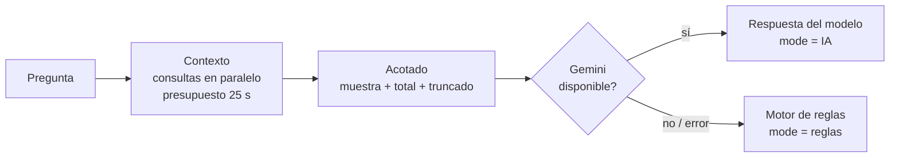

# Agentes de IA

Código: [`ai/`](../../backend/app/ai) (motor con herramientas), [`agents/azure_agent.py`](../../backend/app/agents/azure_agent.py) (respaldo), [`routers/chat.py`](../../backend/app/routers/chat.py).

## Motor con herramientas (chat del panel)

Con un modelo que admite herramientas (Gemini), el chat del panel responde con el motor de agentes ([`app/ai`](../../backend/app/ai), [plan 09](../plan/09-agentes-ia.md)): el modelo pide los datos que necesita, recibe el resultado y sigue hasta responder. Ya no depende de un contexto precargado.

| Herramienta | Qué devuelve | Cita |
|---|---|---|
| `buscar_recursos` | Recursos de Azure, AWS y Kubernetes por nombre, nube, tipo, cuenta, Terraform o creador, ordenados por gasto | Inventario |
| `recursos_nuevos` | Lo aparecido en los últimos N días, con quién lo creó; opcionalmente solo fuera de Terraform | Inventario |
| `hallazgos` | Hallazgos por severidad, estado, nube o texto, con remediación | Gestión de hallazgos |
| `costos` | Gasto de un periodo, comparación y los que más gastan por cuenta, servicio y recurso | Historial de costos |
| `cumplimiento` | Controles de CIS e ISO y cuáles no cumplen | Cumplimiento |
| `clusters_kubernetes` / `estado_cluster` | Flota con salud y soporte; incidencias, pods con su log, cargas, nodos y eventos | Kubernetes |

- **Solo lectura**: las herramientas leen las mismas vistas que el panel (con su caché) y las fotos de Kubernetes; no consultan la nube ni ejecutan nada.
- **Citas**: cada resultado trae el enlace a la vista que lo respalda y el modelo lo cita como `[ver en el panel](#/...)`. El panel solo vuelve clicables los enlaces propios (`#/...`).
- **Topes**: hasta 8 llamadas a herramientas y 90 s por pregunta; al llegar, el modelo responde con lo que tiene. Un resultado de más de 12.000 caracteres se rechaza pidiendo filtros.
- **Respaldo**: si el modelo no admite herramientas o falla, responde el agente anterior (contexto precargado o motor de reglas). La respuesta indica el modo (`llm_gemini_herramientas`).
- **Kubernetes**: la pestaña *Kubernetes* de la consola sigue usando su chat sobre la foto (`/api/k8s/chat`).

### Evaluación

[`backend/eval/agentes.py`](../../backend/eval/agentes.py) siembra una base con datos conocidos y una foto de Kubernetes, y hace 8 preguntas con respuesta verificable (conteos, quién gasta más, recursos creados a mano, causa de un CrashLoop, fin de soporte…). Usa el modelo real:

```bash
cd backend && GEMINI_API_KEY=... python -m eval.agentes
```

Primera medición (29-oct-2026, `gemini-3.5-flash`): **8 de 8 (100 %)**, objetivo 90 %. En la CI corren las pruebas del bucle con un modelo simulado (`tests/unit/test_ai_agente.py`).

## Agentes anteriores (respaldo)

| Agente | `agent_type` | Contexto que recibe |
|---|---|---|
| Inventario y gobernanza | `inventory` | Recursos, grupos, tipos, regiones, cumplimiento de tags, cobertura IaC, recursos sin custodio |
| FinOps | `finops` | Reporte de FinOps (huérfanos con costo real, showback, anomalías), tarifas de referencia |
| SecOps | `secops` | Reporte de SecOps y exposición priorizada |
| SRE Kubernetes | — (`/api/k8s/chat`) | Foto del clúster; ver [kubernetes-sre.md](kubernetes-sre.md) |

Responden en español, con tablas comparativas y comandos `az` o `kubectl` exactos. Se presentan como agentes de `ORG_NAME`.

## Cómo se arma una respuesta



### Una sola definición por regla

Cada regla —qué es un disco huérfano, un Key Vault expuesto, un recurso gestionado por IaC— vive en `kql.py`, `governance.py` o `pricing.py`, y de ahí la leen el panel, los reportes y el chat. El agente **no consulta por su cuenta**: recibe los servicios del panel (`attach_services`) y hereda sus reglas y su caché.

Esto corrigió divergencias reales: el chat contaba como públicas todas las cuentas de almacenamiento mientras el panel filtraba por `allowBlobPublicAccess`, y el reporte de costo del chat publicaba estimaciones bajo una clave llamada "costo real". Ver [ADR 0002](../adr/0002-una-definicion-por-regla.md).

### Presupuesto de contexto

- **Tamaño:** cada lista viaja acotada y declara lo que quedó fuera (`{muestra, total, truncado}`). El modelo dice "hay 212, te muestro 15" en lugar de presentar una página como si fuera todo el inventario. El contexto de SecOps bajó de ~95.000 a ~21.000 caracteres.
- **Tiempo:** todas las consultas comparten un presupuesto único (`PRESUPUESTO_CONTEXTO_SEGUNDOS = 25`). Antes cada una tenía su propio timeout en serie y podían sumar más de 100 s, cerca del corte de 230 s del gateway de App Service. Lo que no llega se anota en `consultas_incompletas` y el resto se responde.

### Robustez

Un recurso sin tags llegaba al contexto como la cadena `"null"`; al deserializarse como `None`, el `.items()` siguiente fallaba dentro del `try` general y el chat respondía con el motor de reglas sin decirlo. Corregido en `_tags_como_dict`, con prueba de regresión en `tests/unit/test_contexto_agente.py`.

## Modelo

Los agentes no conocen el SDK del proveedor: piden texto a [`app/llm`](../../backend/app/llm/__init__.py) con `llm.generar(uso, sistema, mensaje)`.

| Variable | Por defecto | Qué hace |
|---|---|---|
| `LLM_PROVIDER` | `gemini` | `gemini` o `none` (solo motor de reglas) |
| `GEMINI_API_KEY` | vacía | Sin clave, se usa el motor de reglas |
| `GEMINI_MODEL` | `gemini-3.5-flash` | Modelo de Gemini |
| `LLM_TIMEOUT_SECONDS` | `60` | Tiempo máximo por llamada |
| `LLM_MAX_REQUESTS_PER_HOUR` / `_PER_DAY` | `30` / `150` | Consultas al modelo por usuario (0 = sin límite) |

- **Gemini** usa el SDK `google-genai` (`app/llm/gemini.py`). `google-generativeai` ya no tiene soporte y se retiró; la imagen bajó de 533 a 366 MB.
- **Otro proveedor** (Azure OpenAI, Claude) es otra clase con el método `generar()` de [`app/llm/base.py`](../../backend/app/llm/base.py). Ni los agentes ni los endpoints cambian.
- **Fallas**: todo error del proveedor llega como `LLMError`, y cada agente responde con su respaldo. El chat usa el motor de reglas, IaC usa las plantillas y Kubernetes muestra el estado del clúster. La respuesta indica el modo: `llm_<proveedor>_...` o reglas.
- **Consumo**: cada llamada deja una línea `[llm]` en el log con uso, proveedor, modelo, usuario, tokens de entrada y salida, y duración.
- **Límite por usuario** ([`app/llm/limits.py`](../../backend/app/llm/limits.py)): el chat, el agente de Kubernetes, el generador de IaC y el bot de Teams cuentan contra una ventana por hora y otra por día. Al pasarlas responden **429** con `Retry-After`. Solo cuentan las respuestas del modelo: el motor de reglas no tiene límite. El conteo vive en memoria (una réplica); con varias réplicas debe pasar a un almacén compartido.
