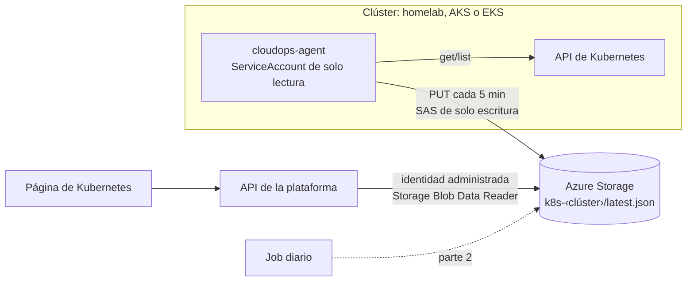

# 8. Reconstrucción del módulo de Kubernetes

El módulo actual solo habla con AKS por Run Command, no está configurado en el despliegue y no tiene página en el panel. Esta reconstrucción lo cambia por un **agente de solo lectura dentro del clúster** que funciona igual en AKS, EKS o un clúster fuera de la nube (homelab, k3s, kubeadm, Talos), porque solo usa el API estándar de Kubernetes.

## Decisión: el clúster envía, la plataforma no entra

| Opción | A favor | En contra | Decisión |
|---|---|---|---|
| **Agente en el clúster que sube una foto a Azure Storage** | Sin abrir puertos ni exponer el API server; sirve para clústeres privados y fuera de la nube; no despierta el API ni la base | Los datos tienen la antigüedad del intervalo (5 min); los logs en vivo necesitan otro canal | **Elegida** |
| La plataforma consulta el API server por un túnel | Datos en vivo y logs a pedido | Guarda una credencial del clúster en Azure; depende del túnel | Descartada |
| Exponer el API server a Internet | Simple | Expone el clúster | Descartada |
| El agente envía al API de la plataforma | Una sola puerta | Cada envío despierta el API: con un envío cada 5 min la réplica no escala a cero y supera el cupo gratuito (~USD 10/mes) | Descartada |

Principios que se mantienen:

- **Solo lectura**: el ClusterRole del agente solo tiene `get`, `list` y `watch`, y nunca lee `secrets` ni `configmaps`.
- **Sin dependencias**: el agente es un script de Python con la biblioteca estándar, montado en la imagen oficial de Python. No hay imagen propia que publicar.
- **Credencial mínima**: cada clúster tiene su propio contenedor y una SAS que solo puede crear y escribir en él (ni leer ni listar). Se revoca rotando la clave de la cuenta.
- **Costo casi cero**: 288 escrituras al día por clúster, centavos al mes.

## Partes

| Parte | Entrega | Criterio de aceptación |
|---|---|---|
| **1. Agente y página** | Agente con manifiestos (`kubectl apply -k`), contenedor y SAS por clúster en Terraform, lectura en el API, página de Kubernetes con clústeres, nodos, cargas, pods con problemas, eventos de advertencia e incidencias con score de salud | El homelab aparece en el panel con datos de menos de 10 minutos y una incidencia sembrada (un pod en CrashLoop) se ve en la página |
| 2. Historia e inventario | El job guarda los clústeres en el inventario (`kubernetes.cluster`), sus nodos y las incidencias con hora de inicio y fin; aviso de agente sin reportar | Una incidencia resuelta queda en la historia con su duración |
| 3. Hallazgos de seguridad del clúster | Reglas en el catálogo: contenedores privilegiados, imágenes `latest` o sin etiqueta, sin límites de recursos, `hostNetwork`/`hostPath`, mapeadas a CIS Kubernetes | Los hallazgos del clúster aparecen en la bandeja con su ciclo de vida |
| 4. Avisos, logs y chat | Avisos a Discord (nodo caído, CrashLoop); últimas líneas de log de los pods con problemas en la foto; el agente de IA responde sobre la foto | Un nodo apagado genera un aviso; el chat explica un CrashLoop con su log |
| 5. Flota y retiro de Run Command | AKS y EKS con el mismo agente; versión y fin de soporte por clúster; se retira el camino de Run Command | El panel lista todos los clústeres con versión y fin de soporte |

## Parte 1 en detalle

1. **Agente** (`k8s-agent/`): lee versión, nodos, namespaces, pods, Deployments, StatefulSets, DaemonSets, Services, EndpointSlices y eventos de advertencia; arma una foto resumida (sin variables de entorno, secretos ni configuración) y la sube comprimida. Detecta la distribución (AKS, EKS, k3s, RKE2 u otra) por la versión y las etiquetas de los nodos.
2. **Infraestructura**: variable `kubernetes_clusters`; un contenedor `k8s-‹nombre›` por clúster; salida sensible con la URL de subida; rol de lector de blobs para el API; variables `K8S_CLUSTERS` y `K8S_SNAPSHOT_ACCOUNT`.
3. **API**: `GET /api/k8s/clusters` (resumen de cada clúster con la antigüedad de su foto) y `GET /api/k8s/clusters/{nombre}` (detalle con incidencias y score). Las reglas de incidencias del servicio actual se trasladan a la foto.
4. **Panel**: página *Kubernetes* en la navegación, con la lista de clústeres y el detalle de cada uno; aviso cuando la foto tiene más de 15 minutos.

## Riesgos

| Riesgo | Mitigación |
|---|---|
| La SAS se filtra desde el clúster | Solo escribe en el contenedor de ese clúster; no lee nada. Rotar la clave de la cuenta la invalida |
| Fotos grandes en clústeres con muchos pods | Se resume por pod (sin el spec completo) y se comprime con gzip; tope de eventos |
| El clúster no tiene salida a Internet | El agente admite `HTTPS_PROXY`; sin salida, el clúster no puede reportar |
| Retención de versiones borradas | La cuenta guarda blobs borrados 7 días: unos MB por clúster |
