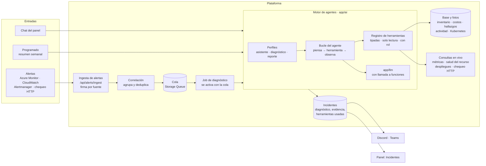
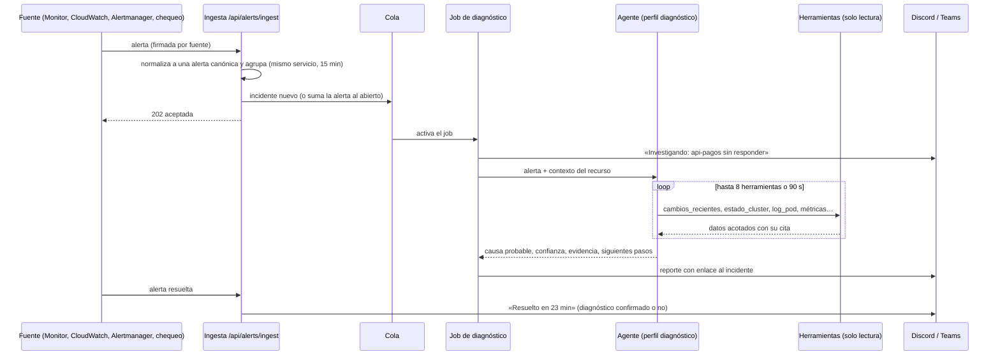

# 9. Agentes de IA y diagnóstico de incidentes

**Decisión propuesta:** un solo motor de agentes con herramientas, dentro de la plataforma, que sirve al chat del panel y a un flujo nuevo de **diagnóstico de incidentes**. Las alertas llegan desde afuera (Azure Monitor, CloudWatch, Alertmanager, chequeos de disponibilidad) por un webhook; un agente investiga con herramientas de solo lectura y publica en Discord o Teams un reporte con causa probable, evidencia y siguientes pasos. Nada se corrige solo ([ADR 0001](../adr/0001-identidad-de-solo-lectura.md)).

## Por qué dentro de la plataforma

Lo que hace útil un diagnóstico no es el modelo, sino el contexto que lo rodea. La plataforma ya tiene ese contexto y las credenciales de solo lectura para obtenerlo; una herramienta externa tendría que duplicar ambas.

| Opción | A favor | En contra | Veredicto |
|---|---|---|---|
| **Dentro de la plataforma** (motor propio, herramientas sobre sus datos) | Usa el inventario canónico, quién creó qué, cobertura de Terraform, hallazgos, costos, fotos de Kubernetes y las identidades de solo lectura que ya existen; mismo canal de avisos, roles y auditoría; el incidente queda en el panel | Hay que construir el ciclo del agente, la ingesta y la evaluación | **Recomendada** |
| Flujo externo (n8n, Logic Apps, Power Automate) con un modelo | Rápido de armar | Credenciales repartidas fuera de la plataforma; el flujo no ve el modelo canónico ni el historial; difícil de probar y versionar | Solo como adaptador de ingesta |
| AIOps comercial (agentes SRE de los proveedores de nube u observabilidad) | Maduro, integrado con su propia telemetría | Atado a una nube o a una herramienta de observabilidad paga; no cruza Azure, AWS y el homelab ni conoce las reglas propias | Fuera de alcance por costo y alcance |

Lo que **sí queda afuera**: la detección. La plataforma no reemplaza a Azure Monitor, CloudWatch ni Prometheus; recibe sus alertas. La única detección propia que se suma es un chequeo de disponibilidad HTTP liviano para quien no tenga monitoreo.

## Hoy

| Aspecto | Estado |
|---|---|
| Agentes | Cuatro (inventario, costos, seguridad y Kubernetes), cada uno con su código y su contexto |
| Contexto | Se precarga y se acota antes de llamar al modelo: el agente solo sabe lo que se le cargó |
| Herramientas | Ninguna: el modelo no puede pedir un dato que no venga en el contexto |
| Respaldo | Motor de reglas cuando no hay modelo o falla |
| Modelo | Gemini por `app/llm` (interfaz de proveedor); **sin clave en producción**, así que hoy responde el motor de reglas |
| Evaluación | No existe (es criterio de salida de la fase 3: 90 % de exactitud) |

## Arquitectura objetivo



### Motor de agentes (`app/ai`)

Reemplaza a los cuatro agentes actuales con una sola pieza:

- **Bucle del agente**: el modelo decide qué herramienta usar, recibe el resultado y sigue hasta responder. Tiene topes por ejecución: llamadas a herramientas, tokens y tiempo total.
- **Perfiles**: cada uso es un prompt de sistema más el conjunto de herramientas que puede usar:
  - `asistente` es el chat del panel y reemplaza a los cuatro agentes;
  - `diagnostico` investiga los incidentes;
  - `reporte` arma los resúmenes narrativos.
- **Herramientas tipadas**: son funciones con esquema de entrada y salida. Cada una declara el rol mínimo, es de solo lectura, tiene su propio timeout y devuelve resultados acotados (`muestra`, `total`, `truncado`). Además trae una **cita**: el enlace a la vista del panel que respalda el dato.
- **Proveedor de LLM**: la interfaz `app/llm` agrega `generar_con_herramientas()`. El motor no depende de qué proveedor esté detrás (Gemini hoy; Azure OpenAI o Claude son otra clase).
- **Respaldo**: sin modelo, el chat sigue respondiendo con el motor de reglas. El diagnóstico manda un reporte determinista con la alerta y los datos que juntan las herramientas, sin conclusiones.

### Herramientas

| Herramienta | Fuente | Perfil | Etapa |
|---|---|---|---|
| `buscar_recursos(filtros)` | Inventario canónico | asistente, diagnóstico | A |
| `cambios_recientes(recurso o cuenta, horas)` | Recursos nuevos o borrados, Activity Log, CloudTrail | diagnóstico, asistente | A |
| `hallazgos(filtros)` | Hallazgos con su estado | asistente, diagnóstico | A |
| `costo_por(dimensión, periodo)` | Historial de costos | asistente | A |
| `estado_cluster(nombre)` / `log_pod(cluster, pod)` | Foto del agente de Kubernetes | diagnóstico, asistente | A |
| `recolectores()` | Ejecuciones del job | diagnóstico | A |
| `chequeo_http(url)` | Petición desde la plataforma (lista de URLs permitidas) | diagnóstico | B |
| `metricas(recurso, métrica, ventana)` | Azure Monitor y CloudWatch (lectura) | diagnóstico | B |
| `salud_recurso(recurso)` | Azure Resource Health, AWS Health | diagnóstico | B |
| `despliegues_recientes(servicio)` | Ejecuciones de GitHub Actions (CD) | diagnóstico | B |
| `logs(consulta)` | Log Analytics o CloudWatch Logs, si existen | diagnóstico | C |

Las herramientas de la etapa A son funciones sobre lo que la plataforma ya guarda: no necesitan permisos nuevos. Las de la etapa B piden permisos de lectura que hoy no están: `Monitoring Reader` en Azure, `cloudwatch:Get*` en el rol de AWS y lectura de las ejecuciones de Actions.

## Flujo de un incidente



**Correlación**: una tormenta de alertas sobre el mismo servicio genera un solo incidente, que acumula las alertas. Se agrupa por recurso o servicio en una ventana de 15 minutos, y el agente se ejecuta una vez por incidente, no una vez por alerta.

**Reporte** (Discord o Teams):

```markdown
[crítica] api-pagos no responde · homelab/demo · hace 4 min
Causa probable (confianza media): el pod reinicia porque no conecta a la base
(«ERROR: no se pudo conectar a db:5432», 8 reinicios en 12 min).
Evidencia
- Deployment api-pagos: 0 de 2 réplicas listas desde 09:41 [Kubernetes]
- Cambio reciente: deploy de la imagen 1.4.2 a las 09:38 [Despliegues]
- Servicio db sin endpoints [Kubernetes]
Siguientes pasos
1. kubectl -n demo get pods -l app=db
2. kubectl -n demo rollout undo deploy/api-pagos (si el cambio de 09:38 es la causa)
Incidente #42 en el panel
```

**Seguimiento**: cuando la fuente envía "resuelto", el incidente se cierra con su duración y el canal recibe un aviso. En el panel, una persona marca si el diagnóstico fue correcto; esa marca alimenta el conjunto de evaluación.

### Fuentes de alertas

| Fuente | Cómo llega | Etapa |
|---|---|---|
| Incidencias del agente de Kubernetes (`k8s-watch`) | Interna: hoy solo avisan; pasan a abrir incidentes | A |
| Chequeo de disponibilidad HTTP propio | Interna: un job cada 5 minutos sobre una lista de URLs | B |
| Azure Monitor | Grupo de acciones con webhook (esquema común de alertas) | B |
| Prometheus Alertmanager (homelab) | `webhook_configs` de Alertmanager | B |
| AWS CloudWatch | Alarma → SNS → suscripción HTTPS | C |

Cada fuente tiene su propio secreto (HMAC o token en la URL), que se valida antes de aceptar una alerta. La ingesta responde rápido y deja el diagnóstico en la cola: así un webhook nunca espera al modelo y el API sigue escalando a cero.

## Otras formas de usar IA en la plataforma

Ordenadas por valor frente a esfuerzo, y todas sobre el mismo motor:

1. **Diagnóstico de incidentes** (este plan).
2. **Resumen semanal narrativo**: qué cambió, qué se rompió, qué se resolvió y en qué subió el gasto. Lo envía el perfil `reporte`; cubre el pendiente de "Qué cambió" con valor sin que nadie pregunte.
3. **Explicación y priorización de hallazgos**: por qué importa este hallazgo en este recurso (expuesto, con datos clasificados, sin Terraform, con costo), más el borrador de la corrección (HCL o `kubectl`). Prepara el PR de remediación.
4. **Anomalías de costo explicadas**: qué servicio y qué recurso explican el salto, cruzado con los cambios recientes.
5. **Clasificación ISO asistida**: el modelo sugiere la clasificación con su justificación y una persona la confirma.

## Seguridad

| Riesgo | Control |
|---|---|
| El agente cambia algo | Todas las herramientas son de solo lectura; ninguna ejecuta comandos. Las correcciones salen como texto para una persona |
| Inyección de instrucciones en alertas o logs | El contenido de alertas, logs y eventos va como dato, nunca como instrucción. Como las herramientas solo leen, el peor caso es un reporte equivocado |
| Fugas de secretos en el reporte | Los logs ya llegan enmascarados del agente de Kubernetes. Se vuelve a enmascarar todo antes de publicar en el canal |
| Alertas falsas o abuso del webhook | Firma por fuente, tope de incidentes por hora y deduplicación |
| Costo del modelo | Topes de herramientas, tokens y tiempo por ejecución; tope diario de diagnósticos; registro `[llm]` de tokens por uso |
| Acceso a datos del chat | Las herramientas corren con el rol del usuario que pregunta; el diagnóstico usa la identidad de la plataforma y sus datos solo llegan al canal configurado |

## Evaluación

- **Chat**: preguntas con respuesta verificable contra datos de prueba, por ejemplo "¿cuántos hallazgos críticos hay en Azure?" o "¿qué recurso gastó más en octubre?". Cada respuesta numérica tiene que coincidir con el panel.
- **Diagnóstico**: incidentes sembrados con su causa conocida. Por ejemplo, CrashLoop por base caída, nodo apagado, imagen inexistente después de un despliegue, recurso creado a mano que rompe una ruta o certificado vencido. Corren con respuestas de herramientas grabadas, igual que las pruebas de contrato.
- Corre en la CI con un modelo real solo en una ejecución nocturna (cuesta tokens); en cada PR, con un modelo simulado que verifica el bucle y las herramientas.
- Criterio de salida de la fase 3: 90 % de exactitud en el conjunto.

## Costo

| Pieza | Costo |
|---|---|
| Cola (Storage Queue) y job de diagnóstico | Centavos; el job corre solo cuando hay incidentes, dentro del cupo gratuito de Container Apps |
| Base de datos | Cada incidente escribe una vez: unas pocas activaciones al mes, dentro del cupo gratuito |
| Modelo | Depende del proveedor y del modelo; se mide con el registro `[llm]` y se limita con los topes. Con un modelo rápido, un diagnóstico de 8 herramientas cuesta centavos |

## Etapas

| Etapa | Entrega | Criterio de aceptación |
|---|---|---|
| **A. Motor con herramientas** · **Hecha** (29-oct-2026; evaluación 8/8) | `app/ai` (bucle, perfiles, registro de herramientas), `generar_con_herramientas` en `app/llm`, herramientas sobre los datos propios, chat del panel unificado con citas, conjunto de evaluación inicial | El chat responde preguntas que hoy no puede (cruces entre inventario, hallazgos y cambios) y cada cifra enlaza al panel |
| **B. Incidentes** | Ingesta firmada, correlación, cola, job de diagnóstico, tabla de incidentes, página *Incidentes*, reporte a Discord o Teams; fuentes: `k8s-watch`, chequeo HTTP propio, Azure Monitor y Alertmanager; herramientas de métricas, salud, despliegues y chequeo HTTP | Un incidente sembrado en el homelab llega al canal con la causa correcta en menos de 3 minutos |
| **C. Proactivo y más fuentes** | Resumen semanal, explicación de hallazgos y de anomalías, CloudWatch, logs | El resumen semanal llega solo y el conjunto de evaluación supera el 90 % |

## Decisiones pendientes

1. **Proveedor y clave del modelo**: Gemini (ya integrado) u otro detrás de la misma interfaz. Sin clave no hay agente con herramientas.
2. **Primeras fuentes de alertas**: recomiendo `k8s-watch` y el chequeo HTTP propio (cero configuración externa), y después Alertmanager si el homelab lo tiene.
3. **Canal de los incidentes**: el mismo webhook de avisos o uno separado para no mezclar incidentes con avisos de costos.
