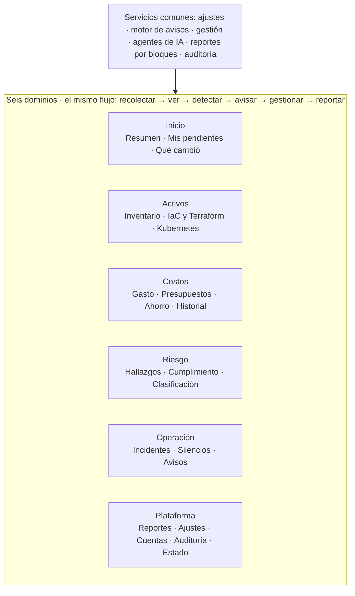
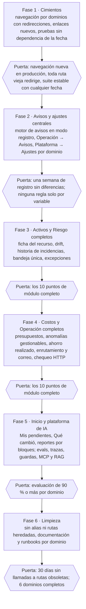

# 10. Reestructuración por dominios

La plataforma creció por entregas y se organizaba por capas técnicas, no por lo que hace la persona. Este plan la reordena en **6 dominios completos**, con un flujo común de punta a punta y la IA como copiloto de cada uno. Son 6 fases desplegables que no rompen lo que ya funciona.

Escrito el 7-nov-2026. La versión para comentar está en Claude Docs ("CloudOps Copilot · Plan de reestructuración por dominios"); esta es la de referencia en el repositorio.

## Por qué

El inventario del 7-nov-2026 mostraba 10 secciones en el panel, unas 70 rutas en el API y 10 módulos documentados, con estos problemas:

| Problema | Dónde se veía | Efecto |
|---|---|---|
| Un mismo concepto en dos secciones | Los hallazgos se gestionaban en Seguridad y se leían por control en Cumplimiento; la clasificación de activos vivía en Cumplimiento | La persona no sabía dónde actuar |
| Ajustes dispersos | Variables de entorno y Terraform (tags obligatorias, presupuestos, horario del job), `ajustes.json` (incidentes, Kubernetes), pestañas de ajustes en cada página, Administración | Cambiar una regla exigía saber en qué capa vivía |
| Cinco emisores de avisos al mismo webhook | `notify` (diario), `k8s_watch` (10 min), `incidentes.reportar` (API), `report` (mensual), `semanal` | Formatos, deduplicación y silencios distintos |
| Dos chats y dos generaciones de agentes | `/api/chat` (`app/ai`) y `/api/k8s/chat`; `app/agents` como respaldo | Respuestas distintas según por dónde se preguntara |
| Rutas heredadas vivas | `/api/stats`, `/api/resources`, `/api/subscriptions`, `/api/recommendations*`, `/api/finops/report` | Dos caminos para el mismo dato |
| Backend por capa técnica | `routers`, `services`, `agents`, `ai`, `readmodel`, `collectors`, `providers`, `reports`, `compliance` | Un cambio de un dominio tocaba de 4 a 6 carpetas |
| Módulos a medio completar | Kubernetes sin historia de incidencias; Costos sin ahorro realizado; IaC sin drift | Cada módulo resolvía una parte del ciclo |
| Nombres mezclados | `finops` y `secops` junto a `inventario` e `incidentes` | Sin un idioma común |

## Principios

1. **Un concepto, un lugar.** Cada entidad (recurso, costo, hallazgo, incidente) tiene un solo módulo dueño; los demás la enlazan.
2. **El mismo flujo en todos:** recolectar, ver, detectar, avisar, gestionar, reportar.
3. **Piezas comunes, no repetidas:** ajustes, avisos, silencios, gestión, agentes, auditoría y reportes son servicios de plataforma.
4. **Solo lectura sobre las nubes:** la plataforma propone y una persona aplica.
5. **Nada se rompe en el camino:** cada fase se despliega sola, las rutas viejas redirigen, los datos se migran.
6. **Costo cero o casi:** la base serverless no se despierta por los jobs frecuentes.

## Módulo completo

La misma lista para los 6 dominios. Una fase no cierra un módulo si le falta un punto.

| # | Pieza | Qué exige |
|---|---|---|
| 1 | Datos | Recolector con su paso en el job, modelo en la base, historia propia y cobertura por cuenta visible |
| 2 | Vista | Resumen arriba, lista con filtros y detalle por elemento, con la misma estructura en todos |
| 3 | Detección | Reglas o umbrales que producen eventos (hallazgo, anomalía, incidencia, cambio) |
| 4 | Gestión | Estado, responsable, notas y línea de tiempo; aparece en *Mis pendientes* |
| 5 | Avisos | Sus eventos salen por el motor común, con severidad, deduplicación y silencios |
| 6 | Ajustes | Sus umbrales y reglas se cambian en *Plataforma → Ajustes*, validados y auditados |
| 7 | IA | Herramientas de solo lectura y al menos una función de IA propia (explica, prioriza o redacta), con casos en la evaluación y respaldo sin modelo |
| 8 | Reporte | Su bloque en el reporte mensual y en el resumen semanal, y su exportación |
| 9 | Permisos | Lector ve, Operador gestiona, Administrador ajusta; el API lo exige |
| 10 | Calidad | Pruebas unitarias, E2E del flujo principal, captura visual y `docs/modules/<dominio>.md` con la misma plantilla |

## Mapa objetivo



| Dominio | Viene de | Falta para estar completo |
|---|---|---|
| **Inicio** | Resumen | *Mis pendientes* (lo asignado a mí, silencios y aceptaciones por vencer), *Qué cambió* desde mi última visita, el último resumen semanal en el panel |
| **Activos** | Inventario, IaC y Kubernetes | Ficha única del recurso (costos, hallazgos, incidentes y cambios), drift de Terraform, historia de incidencias de Kubernetes, el chat de Kubernetes pasa al agente común |
| **Costos** | Costos (`finops`) | Presupuestos editables, anomalías y presupuestos como eventos gestionables, ahorro realizado, pronóstico estacional |
| **Riesgo** | Seguridad (`secops`) y Cumplimiento | Una sola bandeja de hallazgos, excepciones por control con vencimiento, reglas y tags obligatorias configurables |
| **Operación** | Incidentes y los cinco emisores de avisos | Historial de avisos, enrutamiento por severidad, dominio o cuenta, correo, silencios para todo aviso, chequeo HTTP y Azure Monitor como fuentes, cola para el diagnóstico |
| **Plataforma** | Reportes y Administración | Ajustes centrales por dominio, biblioteca de reportes con historial de envíos, estado de recolectores, agentes, base y modelo |

## Servicios comunes

| Pieza | Cómo funciona | Reemplaza |
|---|---|---|
| **Ajustes** | Un registro con esquema por dominio (defecto, tipo, rango) en `ajustes.json` del File Share, con versiones para deshacer; una página *Plataforma → Ajustes*; Administrador, auditado con el antes y el después. Las variables de entorno quedan para secretos e infraestructura; las reglas (tags, presupuestos, topes del modelo) pasan a ajustes y la variable es el valor inicial | Variables de entorno de reglas, ajustes sueltos |
| **Motor de avisos** | Cada dominio publica eventos (dominio, tipo, severidad, clave, enlace); el motor aplica silencios, deduplicación y enrutamiento, arma el mensaje por canal y deja cada envío en un registro visible en *Operación → Avisos*. Corre en el API, el job diario y `k8s-watch` sin abrir la base | Los cinco emisores |
| **Gestión** | Un contrato común: estado, responsable, notas, vencimiento, línea de tiempo. Hallazgos e incidentes ya lo cumplen; anomalías y presupuestos se suman. *Mis pendientes* lee ese contrato | Ciclos de vida distintos |
| **Agentes** | Un motor (`app/ai`) con un registro de herramientas donde cada dominio aporta las suyas; una consola común con el contexto de la página; evaluación por dominio | `/api/k8s/chat`, `app/agents` |
| **Reportes** | Cada dominio aporta su bloque; el mensual, el semanal y los reportes a pedido los arman | Consultas sueltas por reporte |
| **Auditoría y permisos** | Toda escritura con actor, rol, objetivo y detalle; cada ruta declara su rol mínimo | Ya existe; suma el antes y el después de los ajustes |

## La IA en cada dominio

La IA es el copiloto de cada módulo: explica, prioriza y redacta con los datos de la plataforma, y lo que propone lo aprueba una persona.

| Dominio | Qué hace la IA | Ya existe |
|---|---|---|
| **Inicio** | Resumen diario y semanal; *Qué cambió* en tres líneas; *Mis pendientes* ordenado por urgencia con el porqué | Resumen semanal por el canal |
| **Activos** | Explica un recurso en su ficha; detecta huérfanos o sin dueño; propone el `import` de Terraform; explica el drift; diagnostica un clúster | Generador de IaC, chat de Kubernetes, herramientas de inventario |
| **Costos** | Explica por qué cambió el gasto, cruzado con los cambios recientes; causa probable de cada anomalía; ordena el ahorro por monto y esfuerzo; pronóstico contra presupuesto | Herramienta de costos |
| **Riesgo** | Ordena hallazgos por exposición real; explica cada control y su remediación; redacta la justificación de una excepción; propone el cambio en Terraform | Herramientas de hallazgos y cumplimiento |
| **Operación** | Diagnóstico y tormentas; post-mortem; sugiere silencios ante ruido repetido; propone el runbook; chat dentro de cada incidente | Diagnóstico, post-mortem, tormentas |
| **Plataforma** | Narra el reporte mensual; responde sobre la auditoría; recomienda umbrales con la historia propia | — |

Reglas comunes: solo lectura y con aprobación de una persona; cada afirmación cita su vista; evaluación de 90 % o más por dominio, alimentada por las marcas Correcto/Incorrecto; cupo por dominio y respaldo sin modelo; un motor y un modelo cambiable.

## Plataforma de IA

La IA de todos los dominios se apoya en una capa común que la hace medible, observable, segura y consultable desde fuera: **evals continuos** (por dominio, con chequeo de cifras inventadas y regresión desde producción), **trazas** con la convención OpenTelemetry GenAI y una página *Plataforma → IA*, **guardas** contra prompt injection (suite en los evals, contenido delimitado, enlaces permitidos, OWASP LLM Top 10), un **servidor MCP** con las mismas herramientas de solo lectura y **RAG** sobre incidentes resueltos, post-mortems, runbooks y documentación. Es la parte de agentes de la fase 5; el diseño detallado, los criterios de aceptación y los hitos están en el [plan 11](11-plataforma-ia.md).

## Arquitectura por dominios

```
backend/app/
  plataforma/        config, autenticación y roles, auditoría, base, ajustes,
                     motor de avisos, gestión común, motor de agentes, modelo, caché
  proveedores/       azure, aws, kubernetes, memoria (sin cambios)
  dominios/
    inicio/  activos/  costos/  riesgo/  operacion/  plataforma/
  jobs/              diario (pasos que aporta cada dominio), k8s_watch
```

Cada dominio repite la misma forma: `api.py` (rutas con su rol mínimo), `servicio.py` (consultas y reglas), `recolector.py` (su paso del job), `eventos.py` (lo que publica en el motor de avisos), `ajustes.py` (su esquema), `herramientas.py` (para el agente) y `reporte.py` (su bloque). Los modelos se parten en un archivo por dominio dentro de `db/`, con una sola historia de Alembic. El panel sigue la misma forma en `frontend/src/dominios/<dominio>/`.

**Rutas del API**: `/api/<dominio>/<recurso>` en español (`/api/activos/recursos`, `/api/riesgo/hallazgos`, `/api/operacion/incidentes`, `/api/plataforma/ajustes/{dominio}`). Cada dominio cambia sus rutas en la fase en que se muda su código (3 a 5), con las de hoy como alias obsoletos hasta la fase 6: hacerlo antes duplicaría las 70 rutas sin mover nada. No cambian las que usan sistemas externos: `/api/alerts/alertmanager`, `/api/teams/webhook` y la subida de fotos de Kubernetes.

## Fases



La IA entra en cada fase: la 2 le da ajustes y cupo por dominio; la 3 y la 4, las herramientas y funciones de cada dominio; la 5, la consola común, *Mis pendientes* priorizado y los reportes narrados.

### Fase 1 · Cimientos (en curso)

| Entregable | Estado |
|---|---|
| Este plan en el repositorio | Hecho |
| Barra lateral por dominios, con las secciones de cada uno y sin pestañas repetidas | Hecho |
| Redirecciones de todas las rutas viejas del panel (`#/finops/...`, `#/secops/gestion`, `#/incidentes/12`…) | Hecho |
| Enlaces nuevos en avisos, diagnósticos y herramientas del agente | Hecho |
| Pruebas estables con cualquier fecha: la suite corre con el reloj adelantado | Hecho |

### Fase 2 · Avisos y ajustes centrales (en curso)

| Entregable | Estado |
|---|---|
| Registro de ajustes por dominio (incidentes, gobierno, costos, IA, clústeres) con esquema, origen, historial y deshacer | Hecho |
| Tags obligatorias y de showback, presupuestos y topes del modelo pasan a ajustes; la variable es el valor inicial | Hecho |
| *Plataforma → Ajustes* con una sección por dominio y el historial de cambios | Hecho |
| CORS con `PUT` y `DELETE`: guardar ajustes y quitar silencios desde el panel publicado fallaba en el navegador | Hecho |
| Motor de avisos común: los cinco emisores publican por él, con silencios, duplicados y registro | Hecho |
| *Operación → Avisos* con el registro y *Plataforma → Ajustes → Avisos* con el modo | Hecho |
| Una semana en modo registro sin diferencias y paso a `activo` (puerta de la fase) | Desde el despliegue |

### Fase 3 · Activos y Riesgo completos (hecha)

| Entregable | Estado |
|---|---|
| *Activos → Recursos*: lista multinube y ficha única del recurso con explicación de la IA; primer dominio en `app/dominios/` con rutas `/api/activos/...` | Hecho |
| Historia de incidencias de Kubernetes (inicio, fin, duración) | Hecho |
| Riesgo: excepciones por control con vencimiento (con borrador de la IA) y reglas desactivables; dominio en `app/dominios/riesgo` | Hecho |
| Drift de Terraform (Azure): borrados fuera de Terraform y tags cambiadas a mano | Hecho |

### Fase 4 · Costos y Operación completos (hecha; pronóstico estacional y correo quedan para después)

| Entregable | Estado |
|---|---|
| Alertas de costo gestionables (anomalías, presupuestos, export vacío) con explicación de la IA; dominio `app/dominios/costos` | Hecho |
| Seguimiento del ahorro realizado (aplicado, verificado y bajas) | Hecho |
| Severidad mínima por dominio y silencios por tipo de aviso (varios canales: cuando haya un segundo webhook) | Hecho |
| Chequeo HTTP como fuente de incidentes | Hecho |

## Riesgos y compatibilidad

| Riesgo | Mitigación |
|---|---|
| Enlaces guardados y avisos ya enviados apuntan a rutas viejas del panel | Redirecciones en el panel; se retiran en la fase 6, no antes de 60 días |
| Clientes del API llaman rutas actuales | `/api/alerts/alertmanager` y la subida de fotos no cambian; el resto, alias con aviso de obsoleta |
| Mover módulos del backend rompe importaciones | Un dominio por PR, suite y evaluación en verde, reexportaciones durante la transición |
| Pasar reglas de variables a ajustes cambia valores en silencio | La primera lectura toma el valor de la variable; el panel muestra el origen |
| Avisos duplicados o perdidos al unificar emisores | El motor nuevo corre una semana en modo registro y se compara antes de cambiar |
| Pruebas que dependen de la fecha (rompieron `main` el 1-nov y el 7-nov) | Fase 1: fechas fijas en los simulados y la suite corrida con el reloj adelantado |

**Fuera de alcance a propósito:** remediación automática, multiinquilino, GCP y la API pública siguen en la fase 4 del [roadmap original](07-hoja-de-ruta.md).
