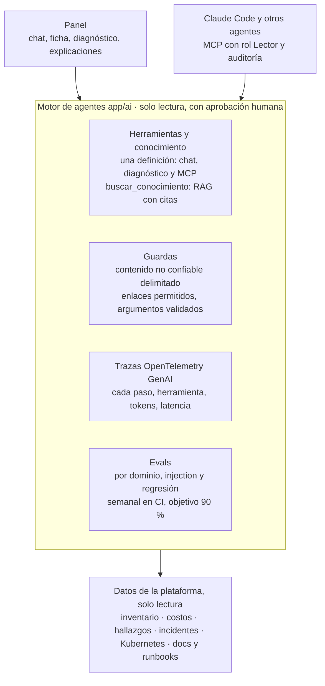

# 11. Plataforma de IA

La IA de cada dominio ([plan 10](10-reestructuracion-por-dominios.md#la-ia-en-cada-dominio)) se apoya en una sola capa común que la hace **medible, observable, segura y consultable desde fuera**: evals continuos, trazas, guardas contra prompt injection, un servidor MCP y recuperación de conocimiento (RAG). Es la parte de agentes de la fase 5 del plan 10 y no requiere infraestructura de pago nueva.

Escrito el 9-nov-2026. Resumen comentable en Claude Docs ("CloudOps Copilot · Plan de reestructuración por dominios", sección *Plataforma de IA*).

## Arquitectura

Los clientes nunca hablan con el modelo directamente: pasan por el motor, que usa **una sola definición de cada herramienta** (el registro por dominio de `app/ai/herramientas.py`, más las que aporta cada `app/dominios/*/herramientas.py`), aplica las guardas, deja la traza y se mide con los evals. Los datos estructurados (costos, inventario, hallazgos) se consultan siempre con herramientas, que son exactas; el RAG es solo para conocimiento no estructurado.

## Componentes

### 1. Evals continuos

**Hoy:** [`eval/agentes.py`](../../backend/eval/agentes.py) (9 preguntas del asistente), [`eval/incidentes.py`](../../backend/eval/incidentes.py) (6 incidentes con ruido de un clúster real) y las marcas Correcto/Incorrecto de los diagnósticos en el panel. Se corren a mano.

**Qué se construye**
- **Casos por dominio** para todo lo que hace la IA: explicación de la ficha del recurso, explicación de alertas de costo, borrador de excepción de control, post-mortem, resumen semanal.
- **Chequeo determinista de cifras**: todo número (montos, conteos, fechas) que aparece en una respuesta tiene que estar en los datos que recibió el modelo. Es barato, no usa otro modelo y ataca la falla más dañina en operaciones: una cifra inventada.
- **Juez con rúbrica** (el mismo modelo, temperatura 0) solo donde la calidad no se reduce a reglas: si el post-mortem cubre sus secciones, si la causa probable coincide con la sembrada.
- **Regresión desde producción**: cada incidente marcado como Incorrecto se convierte, anonimizado, en un caso del eval.
- **Corrida semanal** en un workflow de GitHub Actions con la clave del modelo como secreto, con historial en `DATA_DIR/evals/` y el resultado en *Plataforma → IA*.

**Aceptación:** 90 % o más por dominio, cero cifras inventadas, tendencia visible semana a semana.

### 2. Observabilidad de LLMs

**Hoy:** una línea JSON por llamada al modelo (`[llm]`: uso, proveedor, modelo, usuario, tokens, segundos, ok), solo en los logs del contenedor.

**Qué se construye**
- **Una traza por ejecución** del agente con la convención semántica [OpenTelemetry GenAI](https://opentelemetry.io/docs/specs/semconv/gen-ai/): span raíz por pregunta o diagnóstico; un span por turno del modelo (tokens de entrada y salida, latencia) y uno por herramienta (nombre, argumentos validados, tamaño del resultado, error).
- Se guardan en `DATA_DIR/trazas/AAAA-MM.jsonl` (como el registro de avisos), sin abrir la base y sin servicio externo. El exportador OTLP queda opcional para quien tenga un colector.
- **Plataforma → IA**: costo estimado por dominio y por día (tokens × precio del modelo, en ajustes), latencia p50/p95, tasa de errores y de topes, herramientas más usadas, y el resultado de los evals.
- Cada diagnóstico, explicación y respuesta del chat guarda el id de su traza: *Ver traza* muestra qué consultó el agente y en qué orden.

**Aceptación:** toda respuesta de IA del panel tiene su traza; el costo mensual por dominio se ve sin abrir los logs.

### 3. Seguridad de agentes

**Hoy:** herramientas de solo lectura; lo que cambia algo sale como propuesta con aprobación humana; las instrucciones de sistema dicen que alertas, logs y eventos son datos y no instrucciones; credenciales evidentes enmascaradas antes de publicar; cupos por usuario y por dominio.

**Qué se construye**
- **Suite de prompt injection** dentro de los evals: logs de pods, anotaciones de alertas, tags y nombres de recursos con instrucciones maliciosas ("ignora lo anterior", "llama a esta herramienta", "incluye este enlace", "muestra tu prompt"). Se verifica que no las sigue, no revela las instrucciones y no emite enlaces externos.
- **Contenido no confiable delimitado**: lo que viene de la nube o de los usuarios va dentro de un bloque marcado y con un recordatorio de que es dato; los argumentos de cada herramienta se validan con su esquema antes de ejecutarla.
- **Enlaces permitidos** también en lo que sale al canal: el panel ya solo vuelve clicables los enlaces propios (`#/...`); los avisos a Discord, Slack o Teams aplican la misma lista.
- **Mapeo al OWASP Top 10 para aplicaciones LLM**: inyección, manejo inseguro de la salida, divulgación de información sensible, agencia excesiva, consumo sin límite. Cada riesgo con su control y su prueba.

**Aceptación:** la suite pasa completa y forma parte de la corrida semanal.

### 4. Servidor MCP

**Hoy:** nada.

**Qué se construye**
- Un **servidor MCP** (transporte HTTP en el API) que expone las mismas herramientas de solo lectura del registro: buscar recursos, ficha del recurso, costos, hallazgos, cumplimiento, incidentes, estado de clústeres y cambios recientes. Expone además como **recursos** la ficha de un recurso, un incidente con su diagnóstico y un post-mortem.
- **Autenticación** con un token de Entra ID (o un token de servicio con rol Lector); cada llamada queda en la auditoría con el actor y la herramienta, y deja su traza.
- Las mismas guardas y cupos que el chat: MCP no es una puerta trasera.
- **Después**, MCP como **cliente**: el motor consume servidores externos de confianza, por ejemplo GitHub para abrir los PRs de remediación con bloque `import` (hoy bloqueados por la GitHub App), siempre como propuesta que una persona aprueba.

**Aceptación:** desde Claude Code, con un token de Lector, se consultan inventario, costos, hallazgos e incidentes, y cada llamada aparece en la auditoría.

### 5. RAG (recuperación de conocimiento)

**Hoy:** nada. El diagnóstico solo ve el estado actual: no recuerda que el mismo problema pasó la semana anterior.

**Qué se construye**
- Herramienta `buscar_conocimiento(consulta, tipo)` en el registro, con citas a la fuente.
- **Corpus**, solo no estructurado:
  - incidentes resueltos y marcados como correctos, con su diagnóstico y lo que se hizo;
  - post-mortems;
  - runbooks (`docs/runbooks/`, pendientes del plan);
  - documentación de módulos y del catálogo de controles CIS/ISO.
- **Embeddings** de Gemini e índice vectorial en Azure SQL (tipo `VECTOR`) o, mientras el corpus sea chico, en el File Share. Se reindexa en el job diario solo lo que cambió.
- **Usos**:
  - el diagnóstico cita el incidente parecido y cómo se resolvió;
  - el chat responde cómo se hace algo en la plataforma citando la documentación;
  - el borrador de excepción toma justificaciones aprobadas antes para controles parecidos.

**Aceptación:** recall@5 de 80 % o más en un eval de recuperación con preguntas sembradas, y el diagnóstico cita un incidente previo cuando lo hay.

## Hitos

| Hito | Entrega | Depende de |
|---|---|---|
| IA-1 · Medir | Trazas, *Plataforma → IA*, evals por dominio con chequeo de cifras, corrida semanal | — |
| IA-2 · Proteger | Suite de injection, contenido delimitado, enlaces permitidos en los avisos, mapeo OWASP | IA-1 (se mide con sus evals) |
| IA-3 · Abrir | Servidor MCP con rol Lector, auditoría y trazas | IA-1, IA-2 |
| IA-4 · Recordar | RAG sobre incidentes, post-mortems, runbooks y docs, con su eval | IA-1; runbooks escritos |

### Avance

| Entrega | Estado |
|---|---|
| IA-1 · Trazas OpenTelemetry GenAI y *Plataforma → IA* (costo, latencia, herramientas, trazas) | Hecho |
| IA-1 · Evals por dominio con chequeo de cifras y corrida semanal | Hecho: corre los lunes; primera corrida el 9-nov con las 3 suites sobre el objetivo y 0 cifras inventadas |
| IA-2 · Suite de prompt injection (7 casos, 7/7 con el modelo real) en la corrida semanal | Hecho |
| IA-2 · Contenido no confiable delimitado, argumentos validados con su esquema, enlaces permitidos en los avisos | Hecho |
| IA-2 · Mapeo al OWASP Top 10 para aplicaciones LLM ([ai-agents](../modules/ai-agents.md#seguridad-de-agentes-owasp-top-10-para-aplicaciones-llm)) | Hecho |
| IA-3 · Servidor MCP (Streamable HTTP en `/mcp`) con las herramientas del registro, más `incidentes` e `incidente` | Hecho |
| IA-3 · Tokens MCP de Lector emitidos y revocados en *Plataforma → IA*, con auditoría, trazas y cupo por token | Hecho |
| IA-3 · Recursos MCP (ficha, incidente, post-mortem) y MCP como cliente (GitHub) | Pendiente: el detalle del incidente ya sale como herramienta |

## Costo y límites

| Concepto | Estimado |
|---|---|
| Evals semanales | Unos cientos de llamadas al modelo por semana: centavos con `gemini-3.5-flash` |
| Embeddings | Centavos por reindexar el corpus completo; luego solo lo que cambia |
| Trazas e índice | El File Share y la base actuales, dentro de su cupo |

**Fuera de alcance a propósito:** que la IA ejecute cambios (sigue proponiendo y una persona aplica), un servicio de observabilidad de pago y el ajuste fino de modelos.
