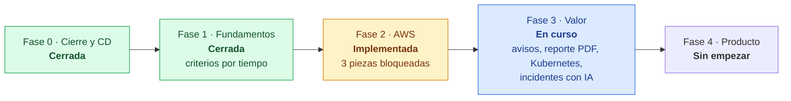

# Pendientes e integraciones futuras

> Registro de lo que falta. Las fases, sus criterios de salida y lo ya hecho están en la **[hoja de ruta](plan/07-hoja-de-ruta.md)**; el análisis completo, en el [plan de evolución](plan/README.md).

Estado al 7 de noviembre de 2026: las fases 0 y 1 están cerradas (sus criterios por tiempo se cumplieron), la fase 2 (AWS) está implementada con tres piezas que esperan recursos en AWS, y la fase 3 avanzó con los avisos, el reporte mensual, el módulo de Kubernetes y los agentes de IA con diagnóstico y gestión de incidentes.

## Criterios que se cumplen con el tiempo

Solo hay que verificarlos en la fecha.

| Fecha | Qué verificar | Fase | Estado |
|---|---|---|---|
| 29-oct-2026 | El job diario lleva 14 días seguidos con éxito | 1 | ✅ Cumplido |
| 4-nov-2026 | Llegó el primer reporte mensual (octubre) con el PDF adjunto | 3 | ✅ Enviado el 4-nov a las 06:15 UTC (el paso de costos falló una vez por Cost Management y el reintento salió bien) |
| 5-nov-2026 | La factura de AWS de octubre coincide con el panel | 2 | ⏳ Pendiente: necesita una sesión SSO de AWS para leer la factura |
| 7-nov-2026 | El panel muestra 30 días de historia propia de inventario, costos y hallazgos | 1 | ✅ Costos con 30 días (9-oct al 7-nov); inventario y hallazgos sin revisar aparte |

## Bloqueados

No avanzan hasta que exista un recurso o se tome una decisión fuera del código.

| Pendiente | Qué lo desbloquea |
|---|---|
| StackSet de cuentas miembro de AWS | Una cuenta miembro en la organización de AWS (hoy solo existe la de gestión). La organización y sus SCP se gobiernan fuera de este proyecto |
| Leer estados de Terraform guardados en S3 | Un bucket de estados de Terraform en AWS |
| Probar el agente en EKS | Un clúster EKS (el agente es el mismo para cualquier clúster) |
| PR de remediación automático | Una GitHub App con permiso para abrir PRs en los repositorios de IaC |

## Fase 3: lo que falta

Tres criterios de salida ya se cumplen: una anomalía sembrada genera aviso, el reporte mensual se envía solo y la evaluación del agente supera el 90 %. Falta el PR de remediación, que está bloqueado. Orden sugerido: de arriba abajo.

| Tarea | Qué entrega | Estado |
|---|---|---|
| Motor de eventos: correo y enrutamiento | Avisos por correo y por canal según severidad o cuenta (hoy un solo webhook) | En parte |
| PR de remediación con bloque `import` | Un hallazgo genera un PR que pasa `terraform plan` sin cambios (criterio de salida) | Bloqueado (GitHub App) |
| Pronóstico con estacionalidad | Hoy anomalías de 14 días y pronóstico lineal; falta estacionalidad semanal y mensual | En parte |
| Seguimiento del ahorro realizado | Registrar recomendaciones aplicadas y el ahorro medido después | Sin empezar |
| Cumplimiento por control con excepciones | Excepciones aprobadas por control, con vencimiento | Sin empezar |
| Diagnóstico de incidentes con IA | Hecho con Alertmanager y a pedido desde una incidencia de Kubernetes ([incidentes](modules/incidents.md)): evaluación 6/6 con ruido, `cambios_recientes` (despliegues de Kubernetes), gestión (estados, responsable, notas, línea de tiempo), silencios, tormentas, ajustes y post-mortem. Falta, de la etapa B del [plan](plan/09-agentes-ia.md): chequeo HTTP y Azure Monitor como fuentes; métricas, salud del recurso y despliegues de la nube como herramientas; cola y job si el diagnóstico en el API se pierde | En parte |
| Kubernetes: historia de incidencias | Lo que falta del [plan del módulo](plan/08-kubernetes.md) (parte 2): incidencias con hora de inicio y fin y su duración. Las partes 1, 3, 4 y 5 están hechas, más incidencias accionables (abrir incidente, silenciar) y ajustes por clúster | En parte |
| Bot de Teams con credencial federada | Volver a aprovisionar el bot sin secreto de cliente | Sin empezar |
| Resumen semanal con IA | Cada lunes al canal: costos contra la semana anterior, hallazgos, incidentes y precisión del diagnóstico, recursos nuevos fuera de Terraform y salud del job ([avisos](modules/notifications-reports.md#resumen-semanal)) | Hecho |
| "Qué cambió" y "Mis pendientes" | Bloques del resumen con los cambios desde la última visita y lo asignado al usuario (los incidentes ya tienen responsable) | Sin empezar |

## Plan de mejoras (noviembre de 2026)

Salió de lo que mostró el laboratorio en la primera semana de incidentes reales.

| Bloque | Qué | Estado |
|---|---|---|
| 1. Incidentes fiables | Tormentas, foto vieja, post-mortem, precisión medida; más control: ciclo de vida, silencios y ajustes; en Kubernetes, incidencias accionables y ajustes por clúster | Hecho (#118, #119). Falta repetirlo en el laboratorio ([ejercicio 5](labs/incidentes.md)) |
| 2. Fiabilidad y mantenimiento | Roadmap al día y ejercicio de tormenta (hechos), runbooks en `docs/runbooks/`, cola y job para el diagnóstico solo si se pierde alguno | En curso |
| 3. Valor diario | Resumen semanal con IA (hecho), "Qué cambió" y "Mis pendientes", seguimiento del ahorro, correo y enrutamiento | En curso |
| 4. Plataforma de IA | Evals continuos, trazas, guardas contra injection, servidor MCP y RAG ([plan 11](plan/11-plataforma-ia.md)) | Planificado (fase 5) |

## Integraciones futuras

Cada integración mantiene la regla de solo lectura: la plataforma propone y una persona aplica.

| Integración | Para qué | Cómo encaja | Costo estimado |
|---|---|---|---|
| Google Cloud (GCP) | Tercer proveedor: inventario, costos (export de facturación a BigQuery), hallazgos | Un `GcpProvider` más en la [capa de proveedores](adr/0006-abstraccion-de-proveedores.md), federado con Workload Identity, sin llaves | Centavos |
| Correo | Avisos para quien no usa Discord, Slack o Teams | Un canal más en el motor de eventos | USD 0 con un plan gratuito |
| Jira, Azure Boards o GitHub Issues | Convertir hallazgos en tickets con dueño y vencimiento | Acción desde la bandeja de hallazgos; el ticket enlaza de vuelta | USD 0 |
| GitHub App | PRs de remediación con bloque `import` | Credencial de la App en el job; un PR por hallazgo | USD 0 |
| Defender for Cloud y Security Hub | Sumar sus hallazgos a la bandeja sin competir con ellos | Recolector que lee sus resultados, si están activos | Lo que cueste activarlos en cada nube |
| Azure Policy y SCP | Políticas como código: estado actual y generación de la política preventiva | Lectura del estado de cumplimiento; genera código para revisar | USD 0 |
| Segundo modelo de lenguaje | Alternativa a Gemini (Azure OpenAI o Claude) | Otra implementación de la interfaz `app/llm` | Según uso |
| API pública | Que otros sistemas consulten la plataforma | Tokens de servicio con rol | USD 0 |

### Resto de la fase 4

1. Costo unitario y reparto del gasto compartido.
2. Drift de recursos gestionados por Terraform.
3. Exposición por rutas (combinaciones de hallazgos).
4. Agente ligero dentro de clústeres privados.
5. Alcance por equipo (multiinquilino interno).
6. Ambiente `prod` separado con aprobación manual (hoy solo existe `dev`).
7. Empaquetado como Helm chart para AKS.

**Fuera de alcance a propósito:** remediación automática, reemplazar un CSPM o un SIEM y orquestar despliegues de aplicaciones.

## Deuda técnica

- [ ] Las pruebas que mezclan fechas fijas con la fecha real se rompen solas con el paso del tiempo (pasó el 1-nov y el 7-nov): buscar las que quedan y fijarlas.
- [ ] Revisar por qué el panel cuenta 8 recursos de AWS en Terraform cuando los estados tienen 9 ARNs.
- [ ] Revisar por qué solo 3 de 9 creaciones de CloudTrail se asocian a un recurso.
- [ ] Crear `docs/runbooks/` con los runbooks del [plan](plan/06-seguridad-calidad-operacion.md#runbooks).
- [ ] Decidir si se despliegan Key Vault (clave de Gemini como referencia de secreto) y Application Insights con tope diario.
- [ ] Convertir moneda en presupuestos y reporte (hoy se suma todo como USD; marcado `shortcut` en el código).
- [ ] Retirar los `from x import *` de los routers.
- [ ] Propagar `forceRefresh` en el camino KQL de `/api/inventory/resources` (hoy se ignora; marcado con `TODO`).
- [ ] Retirar endpoints heredados (`/api/stats`, `/api/resources`, `/api/subscriptions`, `/api/recommendations*`) cuando el panel deje de usarlos.
- [ ] Logging estructurado (JSON) en lugar de `print`, con correlación por petición.
- [ ] Cobertura de pruebas medida en la CI.
- [ ] Hacer configurables las claves de custodio y de evidencia IaC (`governance.py`) igual que las tags obligatorias.
- [ ] Respuestas en streaming en el chat.
- [ ] Generar `frontend/src/lib/types.ts` desde el OpenAPI.
- [ ] Revisión de accesibilidad con lector de pantalla y navegación completa por teclado.
- [ ] Borrar las ramas `feat/*` ya mergeadas en GitHub.
